# Ts65Dn cortical protein signatures

**What does an extra chromosome change in the learning brain, and what does the drug memantine
do about it?** This project answers that question with brain-protein measurements from the
Ts65Dn mouse model of Down syndrome. Every number, figure, the paper, the report and the
slides are generated from the raw data by one command.

**Data:** *Mice Protein Expression*, UCI Machine Learning Repository —
<https://archive.ics.uci.edu/dataset/342/mice+protein+expression> (CC BY 4.0).

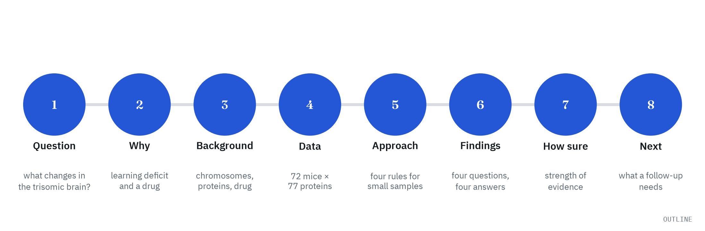

The README, the [report](report/study_report.md) and the
[slides](presentation/presentation.pdf) all follow these eight steps.

| If you want | Read |
|---|---|
| The story in plain language, with pictures | [`report/study_report.md`](report/study_report.md) ([PDF](report/study_report.pdf)) |
| A talk with speaker notes | [`presentation/presentation.pptx`](presentation/presentation.pptx) ([PDF](presentation/presentation.pdf)) |
| The full scientific paper, with methods | [Manuscript source](paper/main.tex) ([PDF](paper/main.pdf)) |
| A hands-on tour of the code | [`notebooks/walkthrough.ipynb`](notebooks/walkthrough.ipynb) |
| Why each statistical choice was made | [`docs/analysis_decisions.md`](docs/analysis_decisions.md) |

## 1. The question

What changes in the brain's proteins when a mouse carries extra copies of Down-syndrome genes,
while it learns and after memantine?

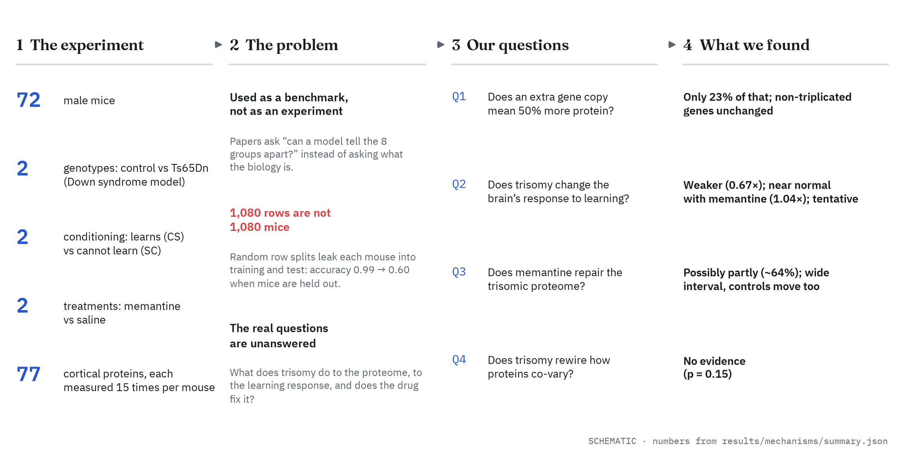

## 2. Why it matters

Down syndrome is the most common genetic cause of intellectual disability. Mice carrying extra
copies of the same genes fail a simple memory test, and memantine restores their learning in
earlier behavioural studies. What happens to brain proteins in between is unclear.

## 3. Background in pictures

| | |
|---|---|
| 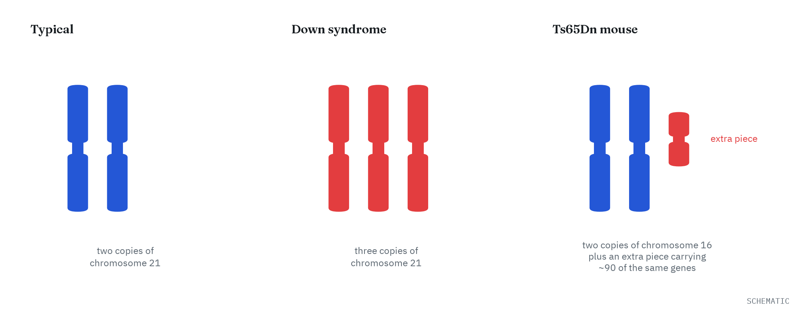 | **The mouse model.** Ts65Dn mice carry an extra piece of chromosome 16 with ~90 of the genes that are triplicated in Down syndrome. |
| 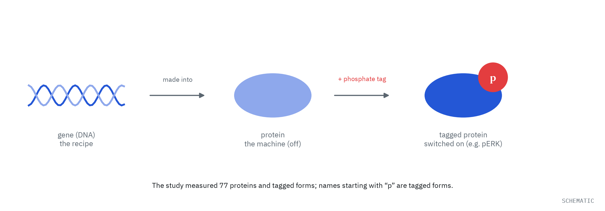 | **Proteins.** Genes make proteins; a phosphate tag switches many on. Names starting with *p* (pERK) are tagged forms. |
| 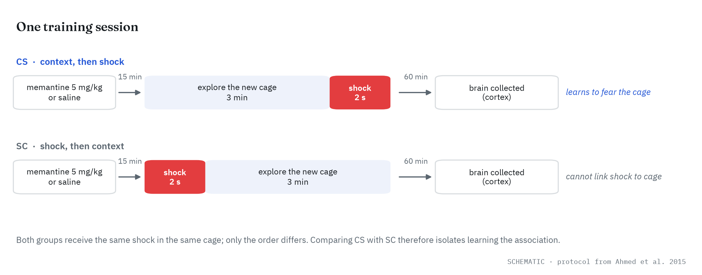 | **The memory test.** CS mice explore, then get a shock, and learn; SC mice get the same shock first and cannot. |
| 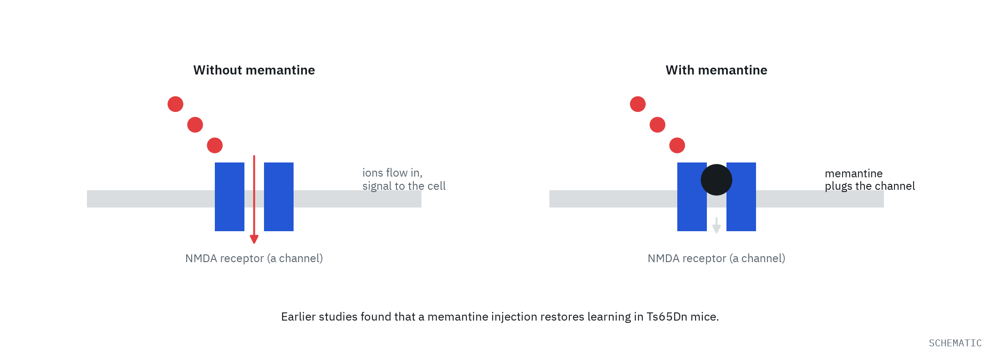 | **The drug.** Memantine partly blocks the NMDA receptor, a channel behind memory signalling. |

## 4. The data

Eight groups of 7–10 male mice (Ts65Dn or control × CS or SC × memantine or saline). Seventy-
seven proteins were measured in the cortex, **15 times per mouse**.

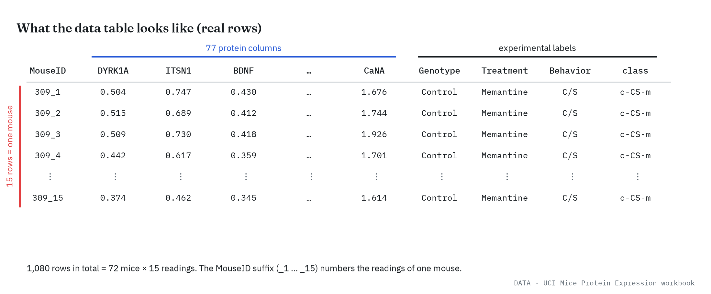

**1,080 rows, but only 72 independent mice.** Every analysis uses one value per mouse.

## 5. Our approach

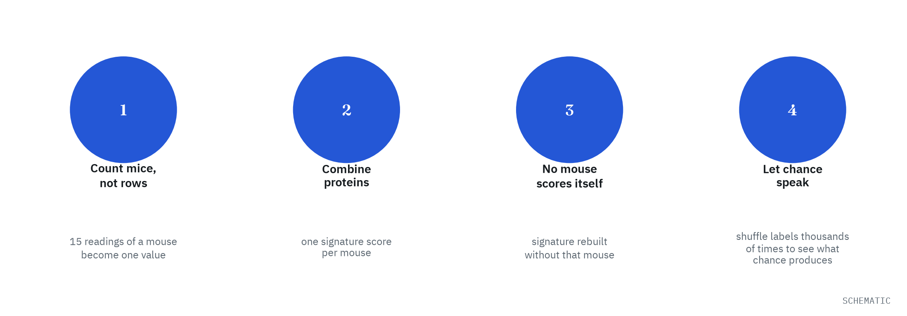

Rule 1 matters most: splitting rows at random lets a classifier recognise mice it has already
seen. Eight-group balanced accuracy is **0.994 with random row splits and 0.602 with whole mice
held out** (chance 0.125).

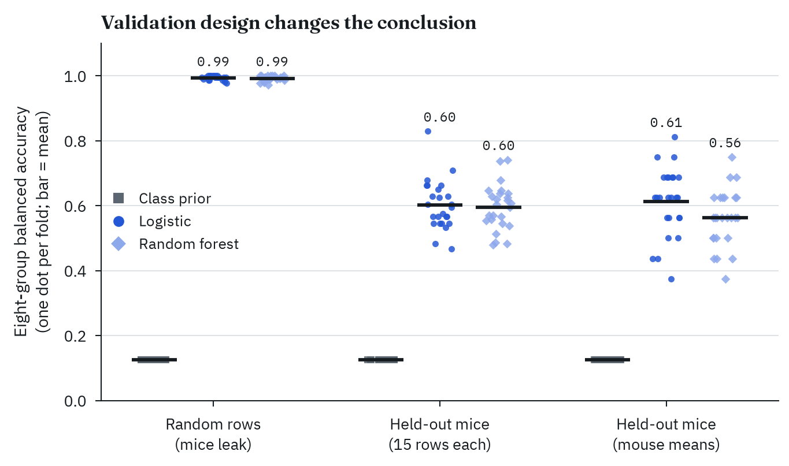

## 6. What we found

| | Question | Answer |
|---|---|---|
| **Q1** | Do extra gene copies make extra protein? | Yes, but six triplicated proteins rose only ~1.10-fold: about 23% of the 1.5-fold expectation on the log₂ scale |
| **Q2** | Does trisomy change the brain's response to learning? | It looks weaker in untreated trisomic mice (0.67× control) and near normal with memantine (1.04×) |
| **Q3** | Does memantine move trisomic mice toward normal? | Possibly: ~64% of the gap, but the interval runs from no shift (−1%) to beyond a full return (171%) |
| **Q4** | Does trisomy rewire how proteins work together? | No difference detected (p = 0.15); only large changes were detectable |

Each question has a workflow diagram (how we answered it) and a result figure in the
[report](report/study_report.md). Exact estimates are in
[`results/mechanisms/summary.json`](results/mechanisms/summary.json).

## 7. How sure we are

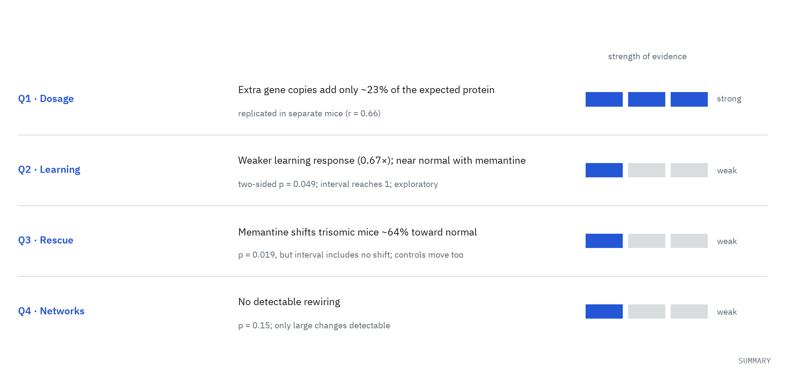

The analyses were not pre-registered and are not corrected across questions, so all p-values
are two-sided and exploratory. They come from one cohort of male mice without independent
replication.

## 8. What's next

A follow-up needs about 10 mice per group to confirm the learning result, many more for
single-protein interactions, female mice, an independent cohort and a memory score for every
mouse.

---

## Run it

Requirements: Python ≥ 3.10. Building the paper and report also needs
[tectonic](https://tectonic-typesetting.github.io) and [pandoc](https://pandoc.org).

```bash
make install      # create .venv and install the package
make reproduce    # tests → lint → analyses → figures → paper, report, slides
make help         # list every target
```

Two environments are pinned to exact versions: `requirements/lock-core.txt` for this study
(scikit-learn 1.9.1) and `requirements/lock-foundation.txt` for the foundation-model study
(scikit-learn 1.6.1 with TabPFN and Kumo). The main analysis takes about two minutes (4,000
bootstrap resamples, 5,000 permutations per test). All settings, including the random seed, are
in [`configs/mechanisms.yaml`](configs/mechanisms.yaml); results are identical across runs.

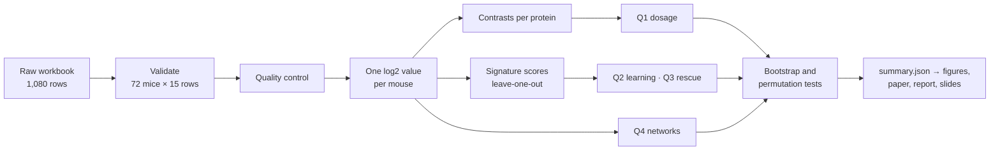

## A second study: tabular foundation models

[`foundation_models/`](foundation_models/) is a separate study on the same data. It asks
whether pretrained models for tables (TabPFN v2 and Kumo Tabular) beat conventional models when
only 72 mice are available, and follows the same eight-step outline.

## Project layout

```text
Data/                 Raw UCI workbook and its provenance
foundation_models/    Separate study: tabular foundation models vs conventional models
src/mice_protein/     Library: data checks, contrasts, signatures, dosage, pathways, networks,
                      quality control, power, plotting style, workflow and explainer graphics
scripts/              Pipelines: analysis → figures → paper, report, slides
configs/              Settings (seeds, resample counts, thresholds)
tests/                Data checks, leakage checks, estimator correctness, determinism
results/
  mechanisms/         Q1–Q4 results: summary.json, tables/, figures/
  figures/            Prediction benchmark, primer and explainer graphics
paper/                LaTeX manuscript; its numbers are generated (paper/generated/)
report/               Plain-language report: template, Markdown, PDF
presentation/         Slide deck: PowerPoint with speaker notes, PDF
notebooks/            Executed walkthrough notebook
docs/                 Analysis decisions and the visual-identity guide
assets/               Fonts (SIL Open Font License) and reproduced published figures (CC BY 4.0)
```

## Quality checks

- **Tests** cover the data checks, leakage-free splitting, the fast leave-one-out scores against
  slow exact refitting, unbiasedness of the noise corrections, recovery of a simulated 50%
  rescue, the group comparisons against SciPy, power against simulation, and identical results
  across Python processes.
- **Continuous integration** runs lint, the tests and a fast run of the full pipeline on every
  push.
- **No hand-typed numbers.** The paper, report and slides read every value from `results/`.
- **Schematics are labelled.** Concept pictures carry a SCHEMATIC tag; result panels show data.

## Visual identity

Figures, paper, report, slides and notebook share one style: IBM Plex Sans, Fraunces and
IBM Plex Mono, with cobalt `#2457D6` and vermilion `#E33D3F` on white. It is implemented in
`src/mice_protein/plotting.py` and described in [`docs/figure_style.md`](docs/figure_style.md).

## Data and references

The data are distributed by the UCI Machine Learning Repository under CC BY 4.0; provenance and
the file checksum are in [`Data/README.md`](Data/README.md).

1. Higuera C, Gardiner K, Cios K. *Mice Protein Expression* [dataset]. UCI Machine Learning
   Repository (2015). doi:10.24432/C50S3Z.
   <https://archive.ics.uci.edu/dataset/342/mice+protein+expression>
2. Ahmed MM et al. Protein dynamics associated with failed and rescued learning in the Ts65Dn
   mouse model of Down syndrome. *PLoS ONE* 10, e0119491 (2015).
3. Higuera C, Gardiner KJ, Cios KJ. Self-organizing feature maps identify proteins critical to
   learning in a mouse model of Down syndrome. *PLoS ONE* 10, e0129126 (2015).
4. Costa ACS, Scott-McKean JJ, Stasko MR. Acute injections of the NMDA receptor antagonist
   memantine rescue performance deficits of the Ts65Dn mouse model of Down syndrome on a fear
   conditioning test. *Neuropsychopharmacology* 33, 1624–1632 (2008).
