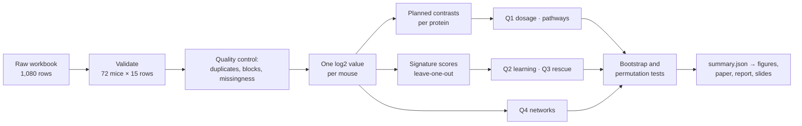

# Ts65Dn cortical protein signatures

**What does an extra chromosome do to the learning brain, and what does the drug memantine do
about it?** This project answers that question with cortical protein measurements from the
Ts65Dn mouse model of Down syndrome, treating the data as the designed experiment they come
from. Every number, figure, the paper, the report and the slides are generated from the raw
data by one command.

**Data:** *Mice Protein Expression*, UCI Machine Learning Repository —
<https://archive.ics.uci.edu/dataset/342/mice+protein+expression> (CC BY 4.0).


## Where to start

| If you want | Read |
|---|---|
| The story in plain language | [`report/study_report.md`](report/study_report.md) ([archived PDF](report/study_report.pdf)) |
| The full scientific paper, with methods | [Manuscript source](paper/main.tex) ([archived PDF](paper/main.pdf)) |
| A talk with speaker notes (18 slides) | [`presentation/presentation.pptx`](presentation/presentation.pptx) ([PDF](presentation/presentation.pdf)) |
| A hands-on tour of the code | [`notebooks/walkthrough.ipynb`](notebooks/walkthrough.ipynb) |
| Why each statistical choice was made | [`docs/analysis_decisions.md`](docs/analysis_decisions.md) |

## The problem

Down syndrome, caused by an extra copy of human chromosome 21, is the most common genetic cause
of intellectual disability. Ts65Dn mice carry an extra copy of about 90 of the same genes, fail
a simple memory task, and learn again after an injection of memantine. A public dataset records
77 brain proteins from these mice, and could show what goes wrong at the molecular level and
what the drug changes.

The dataset is mostly used to benchmark classifiers instead, and that leaves two problems:

1. **Accuracy is overstated.** The 1,080 rows come from only 72 mice, each measured 15 times.
   Splitting rows at random puts the same mouse in training and test data, so a model can score
   well by recognising mice it has already seen.
2. **The biology goes unanswered.** A classifier shows that the groups differ, not *how* they
   differ, which is what the experiment was designed to find out.

## The experiment

| Factor | Levels |
|---|---|
| Genotype | control, **Ts65Dn** |
| Conditioning | **CS** (context, then shock: the mouse learns to fear the box), **SC** (shock first: no association can form) |
| Treatment | **memantine** (an NMDA-receptor blocker), saline |

That gives 8 groups of 7–10 male mice. Seventy-seven proteins and protein modifications were
measured in the cortex, 15 times per mouse.

## Questions and answers

| | Question | Answer |
|---|---|---|
| **Q1** | Do three gene copies give 1.5 times as much measured protein? | Across six selected proteins, the mean log₂ difference was about 23% of the simple 1.5-fold expectation **on the log₂ scale**; observed expression was about 1.10-fold. This does not describe all triplicated genes. |
| **Q2** | Does trisomy change the conditioning-associated protein signature? | The untreated trisomic estimate was 0.67 times the control reference; the treated estimate was 1.04 times that reference. The latter does not establish equivalence or complete restoration. |
| **Q3** | Does memantine move the trisomic signature toward control? | The estimated gap closure was 64%, with a wide bootstrap interval from −1.4% to 170.6%. Magnitude and specificity remain uncertain. |
| **Q4** | Does trisomy change how proteins co-vary? | This analysis detected no difference (p = 0.15); it had limited power for modest changes. |

One methodological result supports these answers: **counting rows as mice inflates
accuracy.** Eight-group balanced accuracy is 0.994 with random row splits and 0.602 when whole
mice are held out (chance: 0.125).

Exact estimates, intervals and tests are in
[`results/mechanisms/summary.json`](results/mechanisms/summary.json). They come from one
cohort of male mice and have not been replicated in an independent cohort.

## How the analysis works



Four rules keep the analysis honest:

1. **The mouse is the unit.** Each mouse's 15 measurements are averaged into one value per protein.
2. **Signatures, not 77 separate tests.** Proteins are combined into one score per mouse for each
   effect, which is far more reliable with 7–10 mice per group.
3. **Axes omit the scored mouse.** Signature axes are rebuilt without the scored mouse, and
   rescue uses separate mice. The pooled label-dependent standardization still uses all mice,
   so these scores are not fully out-of-sample.
4. **Uncertainty from the design.** Mice are re-drawn within groups (bootstrap), and labels are
   shuffled only in ways the design allows (permutation tests).

## Run it

Requirements: Python ≥ 3.10. Building the paper and report also needs
[tectonic](https://tectonic-typesetting.github.io) and [pandoc](https://pandoc.org).

```bash
make install      # create .venv and install the package
make reproduce    # tests → lint → analyses → figures → paper, report, slides
make help         # list every target
```

The main analysis takes about two minutes (4,000 bootstrap resamples and 5,000 permutations per
test). All settings, including the random seed, are in
[`configs/mechanisms.yaml`](configs/mechanisms.yaml), and results are identical across runs.

## A second study: tabular foundation models

[`foundation_models/`](foundation_models/) is a separate study on the same data. It compares
specified TabPFN v2 and NVIDIA Kumo Tabular Small checkpoints with conventional models,
then tests how the comparison changes when independent training mice are scarce. Its
[README](foundation_models/README.md) distinguishes the original committed protocol from
later exploratory analyses and records the remaining baseline and validation gaps.

## Project layout

```text
Data/                 Raw UCI workbook and its provenance
foundation_models/    Separate study: tabular foundation models vs conventional models
src/mice_protein/     Library: data checks, contrasts, signatures, dosage, pathways,
                      networks, quality control, power, obfuscation, plotting style
scripts/              Pipelines: analysis → figures → paper, report, slides
configs/              Settings (seeds, resample counts, thresholds)
tests/                Data checks, leakage checks, estimator correctness, determinism
results/
  mechanisms/         Q1–Q4 results: summary.json, tables/, figures/
  metrics/, tables/, figures/   Prediction benchmark
paper/                LaTeX manuscript; its numbers are generated (paper/generated/)
report/               Plain-language report: template, Markdown, PDF
presentation/         Slide deck: PowerPoint with speaker notes, PDF
notebooks/            Executed walkthrough notebook
docs/                 Analysis decisions and the visual-identity guide
assets/fonts/         IBM Plex and Fraunces (SIL Open Font License)
```

## Quality checks

- **Tests** cover the data checks, leakage-free splitting, the fast leave-one-out scores against
  slow exact refitting, unbiasedness of the noise corrections, recovery of a simulated 50%
  rescue, the group comparisons against SciPy, power against simulation, and identical results
  across Python processes.
- **Continuous integration** runs lint, the tests and a fast run of the full analysis pipeline on
  every push.
- **No hand-typed numbers.** The paper, report and slides read every value from `results/`.

## Visual identity

Figures, paper, report, slides and notebook share one style: IBM Plex Sans, Fraunces and
IBM Plex Mono, with cobalt `#2457D6` and vermilion `#E33D3F` on white. It is implemented once
in `src/mice_protein/plotting.py` and described in [`docs/figure_style.md`](docs/figure_style.md).

## Data and references

The data are distributed by the UCI Machine Learning Repository under CC BY 4.0; provenance and
the file checksum are in [`Data/README.md`](Data/README.md). Fonts are under the SIL Open Font
License (`assets/fonts/OFL-*.txt`).

1. Higuera C, Gardiner K, Cios K. *Mice Protein Expression* [dataset]. UCI Machine Learning
   Repository (2015). doi:10.24432/C50S3Z.
   <https://archive.ics.uci.edu/dataset/342/mice+protein+expression>
2. Ahmed MM et al. Protein dynamics associated with failed and rescued learning in the Ts65Dn
   mouse model of Down syndrome. *PLoS ONE* 10, e0119491 (2015).
3. Higuera C, Gardiner KJ, Cios KJ. Self-organizing feature maps identify proteins critical to
   learning in a mouse model of Down syndrome. *PLoS ONE* 10, e0129126 (2015).
4. Costa ACS, Scott-McKean JJ, Stasko MR. Acute injections of the NMDA receptor antagonist
   memantine rescue performance deficits of the Ts65Dn mouse model of Down syndrome on a fear
   conditioning test. *Neuropsychopharmacology* 33, 1624–1632 (2008).
