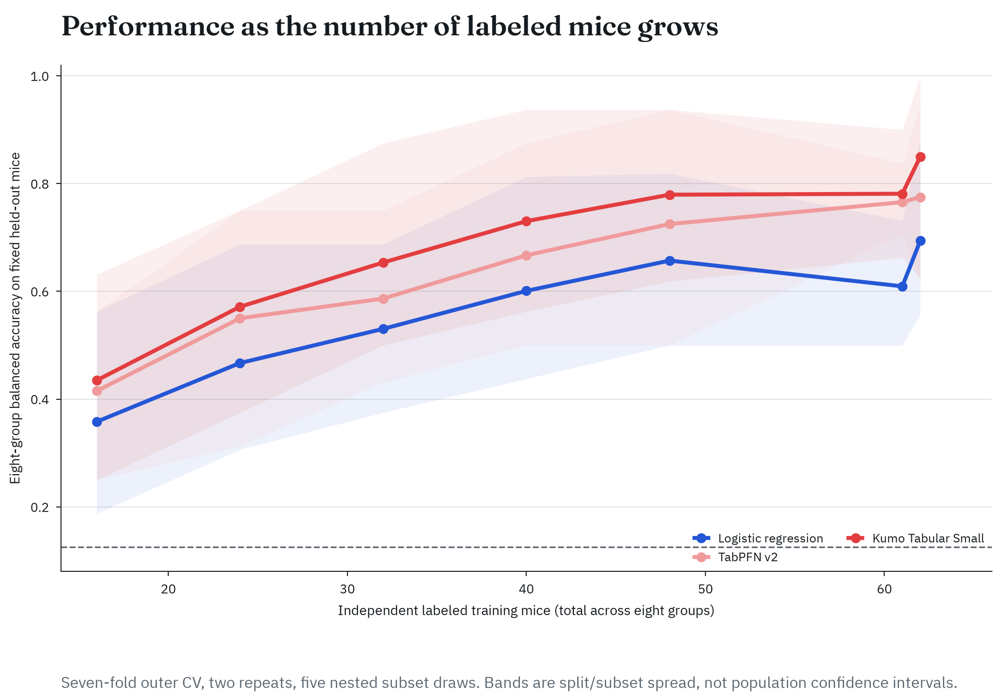

# Learning from 72 mice

Can pretrained tabular models improve prediction when the independent experimental unit is scarce? This study tests specific versions of TabPFN and NVIDIA Kumo Tabular on the Mice Protein Expression cohort. All documents are generated from the same saved results:

| If you want | Read |
|---|---|
| The story in plain language | [`report/study_report.md`](report/study_report.md) ([PDF](report/study_report.pdf)) |
| The full scientific paper | [`paper/main.pdf`](paper/main.pdf) |
| A talk with speaker notes (33 slides) | [`presentation/presentation.pptx`](presentation/presentation.pptx) ([PDF](presentation/presentation.pdf)) |
| A long-form article and a short post | [`article.md`](article.md), [`linkedin.md`](linkedin.md) |
| What was fixed in advance, and what came later | [`docs/study_protocol.md`](docs/study_protocol.md) |



## Design and main observations

The raw workbook contains 1,080 records: 15 repeated measurements for each of 72 mice, across 77 protein-related variables and eight genotype × conditioning × treatment groups. The primary benchmark averages measurements within mouse and holds out whole mice. Its five repeats of five-fold stratified cross-validation use identical splits across models; learned preprocessing and limited tuning remain inside training folds. Chance eight-class balanced accuracy is 0.125.

Direct workbook checks find 7–10 mice per group, 1,396 missing protein readings, and 84 missing cells after mouse aggregation. `pS6_N` exactly duplicates `ARC_N`; seven protein pairs have absolute mouse-level correlation above 0.95 (including that duplicate). One `RRP1_N` reading is negative, so the geometric-mean sensitivity treats it as missing. The original raw workbook is never edited.

The [original committed protocol](docs/study_protocol.md) compared six conventional baselines with TabPFN v2 (`tabpfn==2.2.1`) and Kumo Tabular Small (`structured-data-models==0.3.0`). Kumo averaged 0.818 held-out-mouse balanced accuracy, TabPFN v2 0.744, and fixed-C logistic regression 0.660. [Predictions](results/predictions_class.csv.gz), [splits](results/folds.csv), and [results](results/summary.json) are saved. The original comparison is **not a comprehensive tuned-baseline benchmark**: logistic regression and random forest were not fully tuned, and CatBoost and XGBoost were unavailable locally. A separate [post hoc nested search](configs/tuned_baselines.yaml) tests the locally available conventional models on the same outer folds. Its [results](results/tuned_baselines/performance.csv) move logistic regression to 0.675; Kumo remains at 0.818. The approximate corrected paired-fold interval for Kumo minus tuned logistic includes zero (−0.012 to 0.272; unadjusted p = 0.072). These data do not establish superiority over the tuned model.

The original learning curves changed the test mice as training size increased. A separately labeled [post hoc extension](configs/matched_holdout_review.yaml) keeps each outer test set fixed and draws five nested matched training subsets per outer split. Its [splits](results/matched_holdout_review/splits.csv), [probabilities](results/matched_holdout_review/predictions.csv.gz), and [scores](results/matched_holdout_review/scores.csv) are saved. With 16 labeled mice, Kumo and logistic regression scored 0.435 and 0.358; with 48 mice they scored 0.780 and 0.657. The observed mean gap grew from 0.077 to 0.122, but only 40 of 70 paired subset comparisons showed a larger gap at 48. These are descriptive results from one cohort, not independent biological replications.

The [sensitivity extension](configs/sensitivity.yaml) finds that missingness alone gives near-chance group prediction, while geometric aggregation and removal of duplicate or sparse proteins change scores modestly. Lower log loss is evidence of better probabilistic prediction for these configurations; it does not establish calibration. Representation obfuscation does not rule out benchmark contamination.

The post hoc [SVM decision audit](results/svm_main_audit/pooled_by_repeat.csv) corrects a model-specific scoring issue: `SVC.predict()` and probability argmax disagree, especially with 16 training mice. Tuned SVM classification balanced accuracy is 0.645 using `predict()`, versus 0.604 from the earlier probability argmax. A [factorized logistic baseline](configs/factorized.yaml), built from three binary experimental-factor models, scored 0.663. Its joint probabilities multiply marginal probabilities and assume conditional independence given the protein profile.

## Reproduce

The checked-in raw workbook is unchanged. Python ≥ 3.10 is required. The two model packages and their checkpoints must be locally available; new checkpoint downloads require access to their distributors and applicable licenses. The original run records its environment in [provenance](results/provenance.json); the current five-draw extension has [separate provenance](results/matched_holdout_review/provenance.json). Reruns verify the cached checkpoint hashes before accepting results. Tectonic is needed to rebuild the original PDF paper.

```bash
make install            # core analysis environment
make fm-install         # foundation-model environment; downloads large packages/checkpoints
make fm-experiments     # original committed protocol, full rerun
make fm-matched         # post hoc fixed-holdout learning curves
make fm-matched-review  # post hoc five-draw matched curves used in the article
make fm-sensitivity     # post hoc missingness and aggregation controls
make fm-tuned           # post hoc nested conventional-model search
make fm-factorized      # design-informed factorized baseline
make fm-svm-audit       # SVM classification decision corrections
make fm-runtime         # descriptive timing decomposition
make fm-reproduce       # regenerate analysis tables, figures, and presentation
make fm-all             # single entry point for all available experiments and figures
make fm-docs            # paper, plain-language report and slides (needs tectonic, pandoc)
make test               # data, split and analysis tests
```

The original protocol is preserved for audit. The extension configurations were specified after seeing the original results and are explicitly exploratory. The [paper](paper/main.pdf) reports the pre-specified analyses and labels every later analysis as exploratory; read it with the corrections in the protocol's Section 8: log loss is not a calibration test, the original learning-curve comparison changed test composition, and feature obfuscation is not a contamination proof.

## Limits and provenance

No independent validation cohort was available. Repeated CV uses the same 72 animals, so split-level variation is not population-level uncertainty. [TabPFN-3.5](https://github.com/PriorLabs/TabPFN) is newer than the tested v2 checkpoint; this project does not relabel its older predictions as newer-model results. Its newer checkpoint also has a separate access and license flow. CatBoost, XGBoost, and the newer checkpoint could not be evaluated here because the package index was unreachable and their software/checkpoint artifacts were not installed. The evaluated [TabPFN v2 weights](https://huggingface.co/Prior-Labs/TabPFN-v2-clf) use the Prior Labs license; [Kumo Tabular weights](https://huggingface.co/nvidia/Kumo-Tabular) use OpenMDW 1.1. The original biological paper and this predictive benchmark answer different questions.

The original runtime file mixes model initialization and prediction in the first call. A separate [single-split timing audit](results/runtime_audit/) records construction, fit/context preparation, first prediction, warm prediction, and a logistic hyperparameter search on the same machine. It is descriptive; no monetary or energy-cost claim follows from it.

## Critical review of the claims

| Likely concern | Evidence and limit |
|---|---|
| Independent unit and leakage | Mouse-level splits and a test for fixed held-out mice are in place. Random-row control quantifies the much easier known-mouse task. |
| Fair conventional comparison | Post hoc inner tuning improves logistic regression modestly but omits CatBoost and XGBoost. No claim of superiority to all conventional ML is justified. |
| Sample efficiency | The original curve mixed changing test sets with training size. The matched extension fixes test composition; its overlapping folds and one cohort prevent a population-level cost claim. |
| Reliability | Saved probabilities and a 72-mouse reliability plot support descriptive assessment. Lower log loss is not a calibration test, and a separate calibration set would be very small. |
| Contamination | Checkpoint hashes and package versions are recorded. Feature obfuscation cannot prove a checkpoint has not seen a public dataset; NVIDIA's published Kumo pretraining description says synthetic tables only. |
| Biology and external validity | Factor recovery is descriptive, not causal. No independent cohort tests whether the ranking transfers. |
| Reproducibility | `make fm-reproduce`, tests, and lint pass locally; the paper, report and slides rebuild from saved results. |

Sources: [UCI dataset](https://doi.org/10.24432/C50S3Z), [Ahmed et al. (2015)](https://doi.org/10.1371/journal.pone.0119491), [TabPFN paper](https://doi.org/10.1038/s41586-024-08328-6), [TabPFN v2 model card](https://huggingface.co/Prior-Labs/TabPFN-v2-clf), [Kumo documentation](https://docs.nvidia.com/sdgm/structured-data-models/models/kumo-tabular), [Kumo weights and license](https://huggingface.co/nvidia/Kumo-Tabular).
