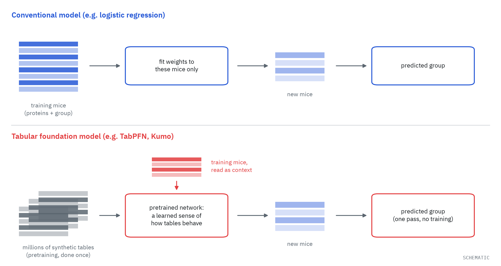

# Learning from 72 mice

**Do pretrained "foundation" models for tables beat conventional models when there are only 72
independent samples?** This study tests TabPFN v2 and NVIDIA Kumo Tabular Small against six
conventional models on the Mice Protein Expression data (UCI Machine Learning Repository,
<https://archive.ics.uci.edu/dataset/342/mice+protein+expression>). All documents are generated
from the same saved results.


| If you want | Read |
|---|---|
| The story in plain language, with pictures | [`report/study_report.md`](report/study_report.md) ([PDF](report/study_report.pdf)) |
| A talk with speaker notes | [`presentation/presentation.pptx`](presentation/presentation.pptx) ([PDF](presentation/presentation.pdf)) |
| The full scientific paper | [`paper/main.tex`](paper/main.tex) ([PDF](paper/main.pdf)) |
| What was fixed in advance, and what came later | [`docs/study_protocol.md`](docs/study_protocol.md) |
| A long-form article and a short post | [`article.md`](article.md), [`linkedin.md`](linkedin.md) |

## 1. The question

Four questions, each with a hypothesis committed before any experiment ran: are foundation
models **more accurate** (RQ1), do they give **better probabilities** (RQ2), do they help
**most with the least data** (RQ3), and are the **scores trustworthy** (RQ4)?

## 2. Why it matters


## 3. Background in pictures



A foundation model was trained once on millions of other tables and predicts new rows by
reading your labeled rows as context.

## 4. The data

72 mice in 8 groups (Ts65Dn or control × learning task or not × memantine or saline), 77
proteins per mouse. The raw table has 1,080 rows because each mouse was measured 15 times; we
average them into one profile per mouse. Chance balanced accuracy is 0.125.

## 5. Our approach


## 6. What we found

| | Planned result | Later, exploratory check |
|---|---|---|
| **RQ1** Accuracy | Kumo 0.818, TabPFN 0.744, logistic regression 0.660; Kumo beat all six baselines, TabPFN did not beat logistic regression | Tuned logistic regression reached 0.675; Kumo's lead is no longer statistically clear (95% interval −0.012 to 0.272) |
| **RQ2** Probabilities | Kumo had the lowest log loss | Lower log loss is not, by itself, a calibration test |
| **RQ3** Small data | Hypothesis not supported: the lead did not shrink with more data | Matched curve: Kumo 0.435 vs 0.358 at 16 mice, 0.780 vs 0.657 at 48; only 40 of 70 draws had a larger gap at 48 |
| **RQ4** Controls | Shuffled labels → chance; row leakage inflates every model; hiding dataset identity barely changes accuracy | Obfuscation cannot rule out exposure to this public dataset |


## 7. How sure we are


The accuracy and probability hypotheses were informed by an earlier benchmark on the same data;
the learning-curve hypothesis and two controls were blind. Everything added later is labelled
exploratory. At package-default ensemble sizes, TabPFN scored 0.727 and Kumo 0.807, so the
conclusions do not depend on the 4-estimator setting.

## 8. What's next

Compare against a well-tuned simple model, split by independent unit, report probabilities, and
use corrected statistics. Open: CatBoost and XGBoost baselines, newer model versions and an
independent cohort.

---

## Reproduce

The checked-in raw workbook is unchanged. Python ≥ 3.10 is required. The two model packages and
their checkpoints must be locally available; reruns verify cached checkpoint hashes before
accepting results. Tectonic and pandoc are needed for the PDFs.

```bash
make install            # core analysis environment
make fm-install         # foundation-model environment; downloads large packages/checkpoints
make fm-experiments     # pre-specified protocol, full rerun
make fm-matched-review  # exploratory five-draw matched curves
make fm-sensitivity     # exploratory missingness and aggregation controls
make fm-tuned           # exploratory nested conventional-model search
make fm-factorized      # design-informed factorized baseline
make fm-svm-audit       # SVM classification decision audit
make fm-runtime         # descriptive timing decomposition
make fm-reproduce       # regenerate tables, figures, paper, report and slides
make fm-all             # every available experiment and figure
```

## Details for specialists

- **Data checks.** 7–10 mice per group, 1,396 missing protein readings, 84 missing cells after
  mouse aggregation. `pS6_N` exactly duplicates `ARC_N`; one `RRP1_N` reading is negative and is
  treated as missing in the geometric-mean sensitivity.
- **Splits.** Five repeats of five-fold stratified cross-validation with identical splits across
  models; preprocessing and limited tuning stay inside training folds. Saved:
  [predictions](results/predictions_class.csv.gz), [splits](results/folds.csv),
  [results](results/summary.json).
- **Statistics.** Nadeau–Bengio corrected resampled t-test, Holm-adjusted across six baselines.
- **SVM audit.** `SVC.predict()` and probability argmax disagree, especially with 16 training
  mice; tuned SVM scores 0.645 with `predict()` versus 0.604 with argmax.
- **Factorized baseline.** Three binary factor models combined under conditional independence
  scored 0.663.
- **Runtime.** A [single-split timing audit](results/runtime_audit/) is descriptive; no cost or
  energy claim follows from it.
- **Versions and licences.** `tabpfn==2.2.1` with the
  [TabPFN v2 weights](https://huggingface.co/Prior-Labs/TabPFN-v2-clf) (Prior Labs licence);
  `structured-data-models==0.3.0` with [Kumo Tabular weights](https://huggingface.co/nvidia/Kumo-Tabular)
  (OpenMDW 1.1). Newer TabPFN releases were not tested.

| Likely concern | Evidence and limit |
|---|---|
| Independent unit and leakage | Mouse-level splits; the random-row control quantifies the easier known-mouse task |
| Fair conventional comparison | Post hoc tuning improves logistic regression; CatBoost and XGBoost were not tested |
| Sample efficiency | The matched extension fixes test composition; overlapping folds and one cohort prevent a population-level claim |
| Reliability | Lower log loss is not a calibration test; a separate calibration set would be very small |
| Contamination | Obfuscation cannot prove a checkpoint never saw a public dataset; NVIDIA describes Kumo's pretraining as synthetic only |
| External validity | No independent cohort tests whether the ranking transfers |

Sources: [UCI dataset](https://doi.org/10.24432/C50S3Z),
[Ahmed et al. (2015)](https://doi.org/10.1371/journal.pone.0119491),
[TabPFN paper](https://doi.org/10.1038/s41586-024-08328-6),
[TabPFN v2 model card](https://huggingface.co/Prior-Labs/TabPFN-v2-clf),
[Kumo documentation](https://docs.nvidia.com/sdgm/structured-data-models/models/kumo-tabular),
[Kumo weights and licence](https://huggingface.co/nvidia/Kumo-Tabular).
