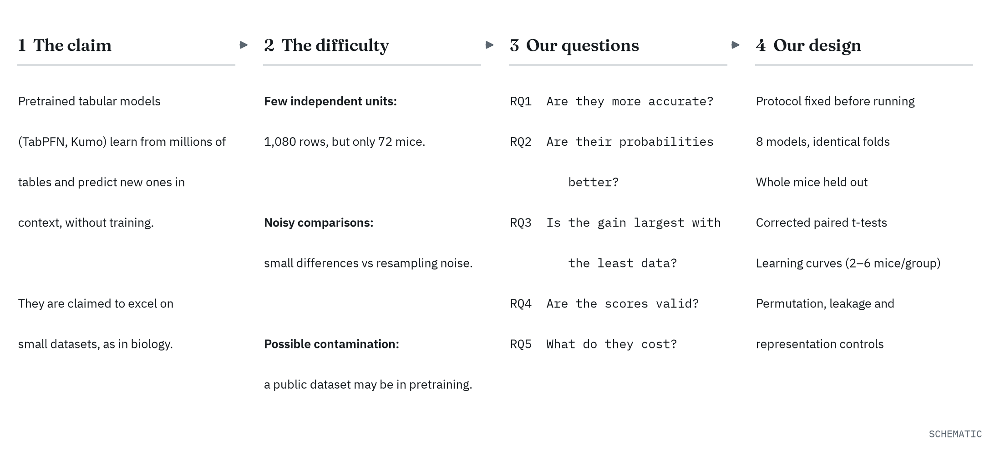
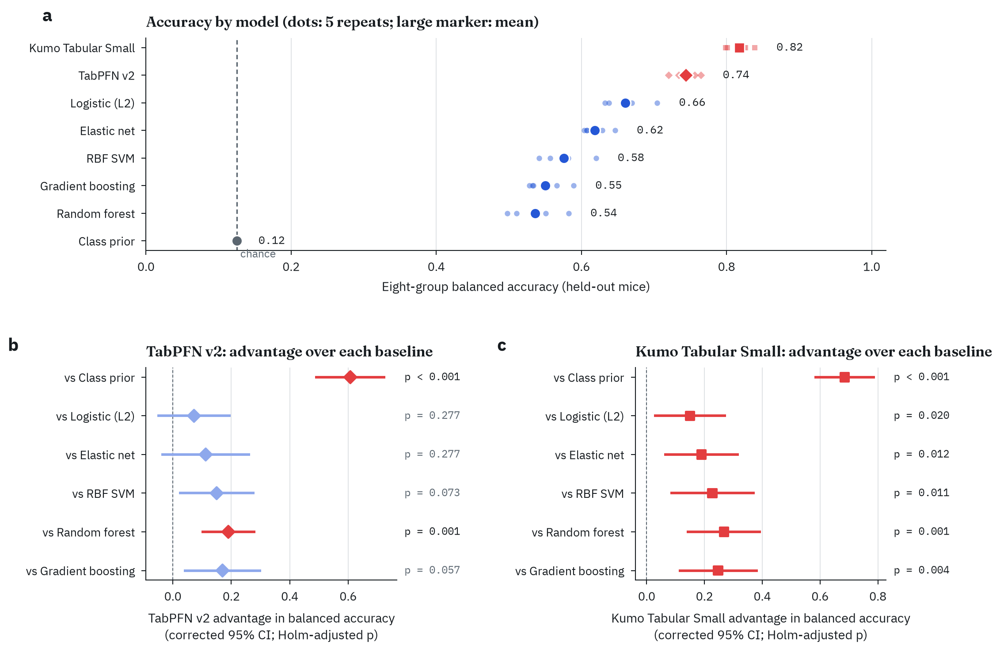
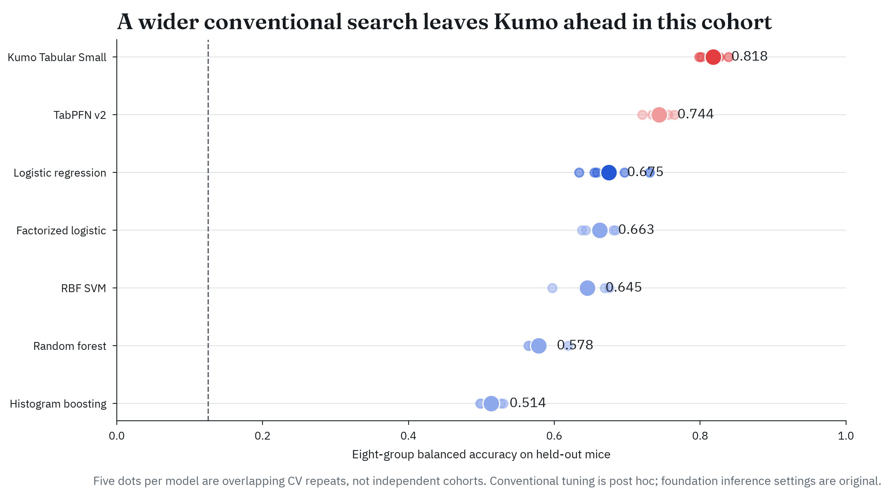
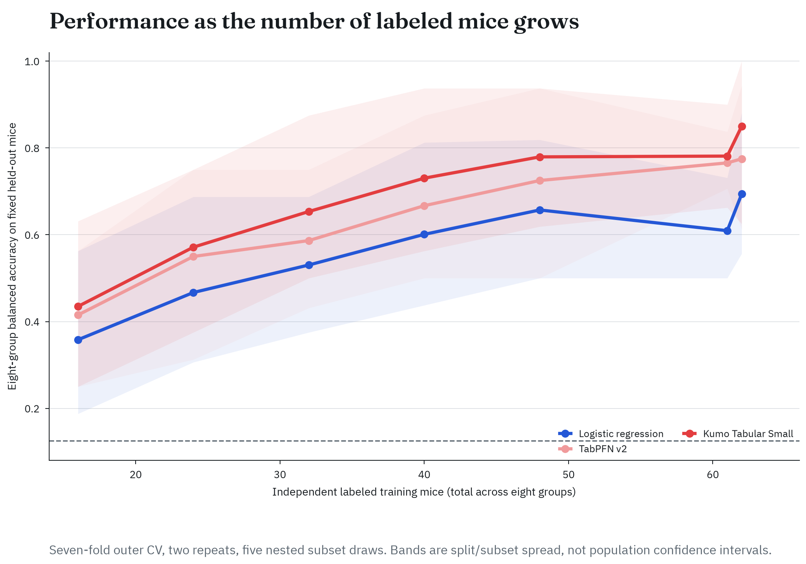
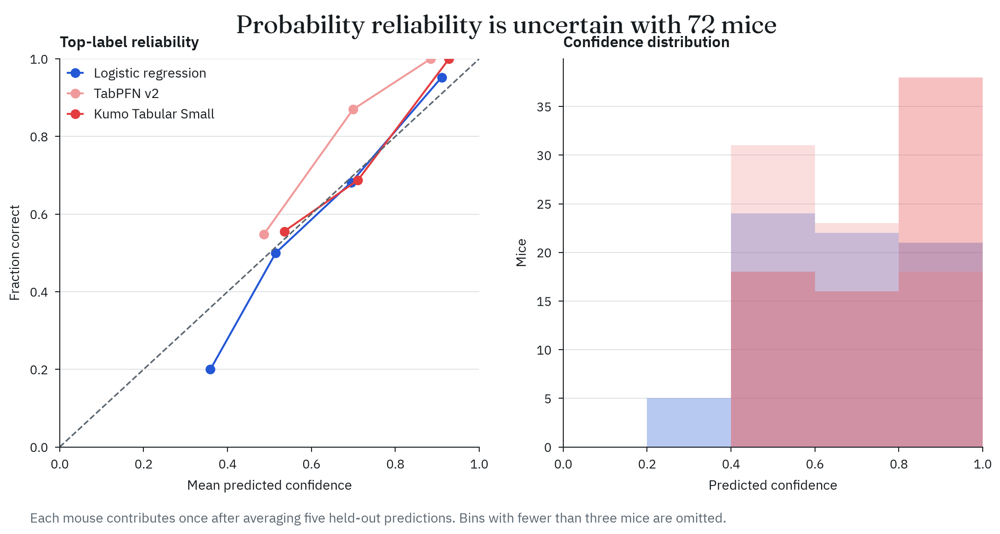
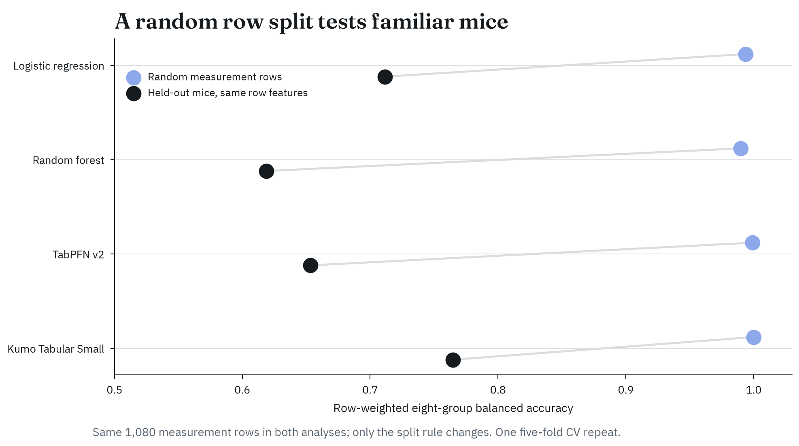
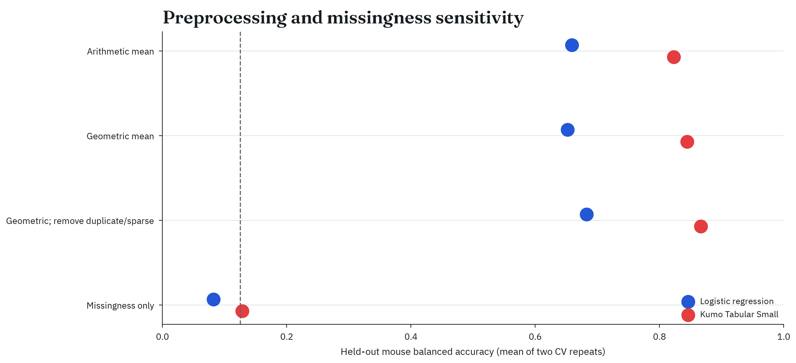
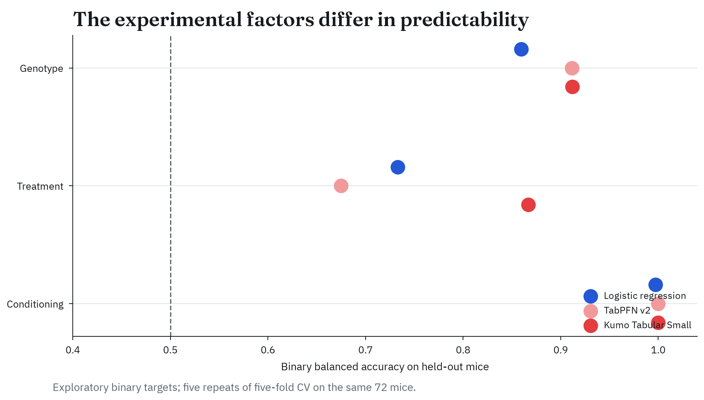

# Learning from 72 mice: what tabular foundation models add, and what they cannot settle

*A controlled case study of TabPFN v2, NVIDIA Kumo Tabular Small, and conventional classifiers on repeated protein measurements.*

When an experiment produces a table, a foundation model can look unusually attractive: it arrives pretrained and can predict from a small labeled set without fitting a task-specific neural network. I wanted to know whether that advantage survives the constraints of experimental science, where another measurement of the same animal does not buy another independent sample.

This study uses the [Mice Protein Expression dataset](https://archive.ics.uci.edu/dataset/342/mice+protein+expression). It is often described as a table with 1,080 rows and 77 protein-related variables. The useful count for generalization is **72 mice**. Each mouse contributed 15 measurements from a dilution series printed in triplicate. The [original biological study](https://doi.org/10.1371/journal.pone.0119491) describes that measurement process; the UCI page also lists 72 animals, although one sentence there incorrectly calls every measurement an independent mouse. I treat the mouse as the unit throughout the primary analysis.

The mice vary by genotype (control or Ts65Dn, a Down syndrome model), conditioning order (context before shock or shock before context), and injection (saline or memantine). Those factors form eight groups with **7–10 mice each**. The biological study asked how cortical proteins change with learning, genotype, and treatment. My machine learning question is narrower: can a model predict the experimental group of a new mouse from its protein profile? Good classification does not establish a causal protein mechanism.

## A comparison that respects the experiment

I averaged the 15 measurements of each protein within each mouse, giving one 77-variable profile per animal. I compared a class-prior dummy, regularized logistic regression, elastic-net logistic regression, an RBF support vector machine, random forest, histogram gradient boosting, [TabPFN v2](https://huggingface.co/Prior-Labs/TabPFN-v2-clf), and [NVIDIA Kumo Tabular Small](https://huggingface.co/nvidia/Kumo-Tabular). The software used `tabpfn==2.2.1` and `structured-data-models==0.3.0`, each with four inference estimators on CPU. These are the **specific versions evaluated**, not claims about the newest release of either family.

The original comparison uses five repeats of five-fold stratified cross-validation. Every model receives the same held-out mice. Imputation, scaling, and the limited hyperparameter searches occur within training folds; the saved [mouse-level predictions](results/predictions_class.csv.gz), [fold assignments](results/folds.csv), and [configuration](configs/study.yaml) make the calculation inspectable. The primary metric is eight-group balanced accuracy, the mean recall across groups; chance is 0.125.

In that comparison, Kumo averaged **0.818** balanced accuracy, TabPFN v2 **0.744**, and L2 logistic regression **0.660**. The paired fold differences favor Kumo over the baselines included in the original protocol, but I would not call this a settled foundation-model win. Logistic regression and random forest were not comprehensively tuned, and CatBoost and XGBoost were not available in the local environment. A model can be the best of those tested without being the best conventional option. The corrected repeated-CV test in the original study is preferable to treating folds as independent, yet its interval still describes this cohort and this resampling procedure, not variability across new biological cohorts.

I then ran a **post hoc** nested search for four conventional models on the same saved outer splits. The wider search moved logistic regression to **0.675**, SVM to **0.645** using its classification decision rule, and random forest to **0.579**; histogram boosting scored **0.514**. Kumo remained ahead of these locally available models by **0.143** balanced-accuracy points relative to the strongest tuned baseline when scores were pooled by repeat. Each model was selected by three-fold inner CV, with candidate grids recorded [in the configuration](configs/tuned_baselines.yaml). On the 25 paired **fold** scores, the Kumo-minus-tuned-logistic difference was **0.130**, with an approximate corrected 95% interval of **−0.012 to 0.272** (*p* = **0.072**, unadjusted). The point estimate favors Kumo, but these data do not establish superiority over tuned logistic regression. Fold and pooled-repeat averages differ because classes are unevenly represented across small folds. The dots below are five overlapping CV repeats, not independent cohort estimates. CatBoost and XGBoost remain an important open comparison.

The eight classes are a product of three binary experimental factors, so I also tried a design-informed baseline: three separately tuned logistic classifiers for genotype, conditioning, and treatment, followed by reconstruction of the eight-group prediction. It scored **0.663** balanced accuracy, close to the direct tuned logistic model and below Kumo in this cohort. Multiplying its three marginal probabilities to obtain a joint distribution assumes conditional independence of the factors given the protein profile; the classification decision can also be read simply as the tuple of the three binary decisions. This is a useful negative result for the idea that factorizing the label automatically makes the task easier.

## Does the advantage grow when labels are scarce?

This is the question that matters most to me. The first learning-curve implementation drew a new training set at each size and tested on all remaining mice. That changes the test composition as the training set grows. I therefore specified a **post hoc, exploratory extension**: seven-fold outer splits, repeated twice; the same held-out mice for every model and training size within a split; and nested training subsets with 2, 3, 4, 5, or 6 mice per group. I later repeated the subset sampling with **five nested draws per outer split** for the three headline models. The full outer training set adds 61 or 62 mice. Seven folds are necessary to leave six of the smallest class's seven mice available for training. No test mouse enters a training subset. The revised [plan](configs/matched_holdout_review.yaml), [assignments](results/matched_holdout_review/splits.csv), [probabilities](results/matched_holdout_review/predictions.csv.gz), and [paired gaps](results/matched_holdout_review/paired_gaps.csv) are saved. The earlier one-draw run remains available as an exploratory audit trail.

With **16 labeled mice** total, Kumo averaged **0.435**, TabPFN v2 **0.415**, and logistic regression **0.358**. With **48 labeled mice**, the same models averaged **0.780**, **0.725**, and **0.657**. Kumo's mean lead over logistic regression was **0.077** at 16 mice and **0.122** at 48. That direction appeared in **10 of 14** outer splits after averaging their subset draws, but the paired difference varied widely: **40 of 70** individual matched draw comparisons favored a larger gap at 48. The data suggest a larger average advantage with more labels; they do not establish a dependable trend for new cohorts. The bands show split and subset variability, not confidence intervals for a population of future mice. No training-size threshold or experimental cost saving is established by this curve.

At the smallest sizes, all methods are unstable: a single misclassified animal can move eight-group balanced accuracy substantially. Conventional models also had fixed small-data settings here; a larger tuning study might move their curves. The comparison is useful evidence about these particular configurations, not a universal ranking.

One conventional-model audit changed the analysis. Scikit-learn's SVC can return a class from `predict()` that differs from the largest entry of `predict_proba()`, because its probabilities use a separate internal calibration procedure. In the original one-draw learning run with 16 training mice, SVM balanced accuracy was **0.058** by probability argmax but **0.277** by its classification decision. The two rules disagreed on **643** held-out predictions across that run. I use `predict()` with probability estimation disabled for SVM classification; probability scores, when reported, are a separate evaluation. The old SVM curve is excluded from the revised headline figure. [The decision audit](results/svm_decision_audit/scores.csv) preserves both results.

## A good probability forecast is not automatically calibrated

The original held-out predictions give Kumo a multiclass log loss of **0.565** versus **0.761** for TabPFN v2 and **1.227** for logistic regression. Log loss rewards assigning probability to the correct class, so it mixes discrimination and probability quality. It does **not** by itself demonstrate calibration. I plotted top-label reliability after averaging each mouse's five held-out probability vectors so each animal contributes once.

The diagram is informative about gross overconfidence, but sparse bins and only 72 distinct mice make small calibration differences hard to resolve. The original 10-bin expected calibration error should likewise be read descriptively. Proper calibration would need a separate calibration partition inside every training fold, which is especially costly when a class has only seven mice. I did not use outer test labels to calibrate any model.

The [mouse-level error audit](results/error_audit_by_mouse.csv) also keeps the extremes visible: after averaging its five held-out predictions for each mouse, Kumo's most confident wrong classification still carried **0.787** probability. A correct prediction for another mouse carried only **0.515**. Confidence ranks errors imperfectly here, so neither a low log loss nor an attractive reliability curve makes an individual prediction safe to treat as a biological conclusion.

## Controls that changed my interpretation

The most dramatic control holds the input representation constant: it trains on individual measurement rows, once with random row splits and once holding out whole mice. Random row splits gave balanced accuracy near **1.0** for all four tested models; holding out mice gave **0.62–0.76**. The random split asks whether a model can recognize more measurements from mice it has already seen. It does not estimate performance on new mice. These row-level scores are also a different estimand from the primary mouse-mean benchmark.

Ten mouse-level label permutations brought mean performance near the 0.125 chance level, as expected. This is a useful pipeline check, not proof that all leakage is absent. I also tested an input made only of each protein's missingness fraction across the 15 measurements: Kumo scored **0.128** and logistic regression **0.082** over two five-fold repeats. The observed group signal therefore does not appear to come from missingness alone in these configurations. Missingness can still affect models that use expression and missingness jointly.

A post hoc representation check found Kumo at **0.823** with arithmetic mouse means, **0.845** with geometric means, and **0.867** after removing an exact duplicate protein and proteins sparse in the training fold. Those differences are exploratory; I did not choose the primary representation by looking for the highest score. Renaming, reordering, and positively rescaling the original inputs changed both foundation models little. That check cannot rule out benchmark contamination: preprocessing can erase those transformations, and a model might recognize structure without names. [NVIDIA documents](https://docs.nvidia.com/sdgm/structured-data-models/models/kumo-tabular) synthetic-only pretraining for Kumo Tabular, reducing the direct public-table exposure concern for that checkpoint; checkpoint-specific training provenance still matters. The cohort has no independent external validation set.

## The experimental factors

The eight-group task is not equally difficult in every direction. In exploratory binary analyses, conditioning was almost perfectly recoverable for several models, while treatment was harder. Kumo's treatment balanced accuracy was **0.867** in the original repeated-CV run; logistic regression's was **0.733**. These are computational observations from one cohort, not evidence that a protein causes a treatment response.

## CPU timing, with the operations separated

I measured model construction, task fitting or context preparation, and prediction on one fixed split of 57 training and 15 test mice, using two CPU threads on an Apple Silicon laptop. Across three warm repetitions, median prediction time was about **0.001 s** for fixed-C logistic regression, **1.122 s** for TabPFN v2, and **0.569 s** for Kumo Small. Kumo's first prediction took **24.658 s** because that call also loaded its cached checkpoint; later calls reused the model in memory. A five-candidate, three-fold logistic search took **0.075 s** on this split. The [timings and hardware record](results/runtime_audit/) specify what was measured. These numbers describe this machine and software, not monetary cost, energy, or pretraining cost.

## What I would take into the next experiment

For a data-limited scientific project, I would try a pretrained tabular model alongside a tuned linear model and strong boosted-tree baselines, then check three things before interpreting a gain: **what counts as an independent sample, whether the test set stays fixed in a learning curve, and whether probability quality holds up on genuinely new units**. This case suggests Kumo can be useful even with only tens of labeled animals, but it does not demonstrate that foundation models are generally superior or that they save a known number of experiments.

The remaining work is substantial: run CatBoost and XGBoost with fair nested tuning, evaluate a newer TabPFN checkpoint under its actual license and software requirements, expand the negative controls, and replicate on an independent experimental cohort. The source study used multiple array print runs, but this workbook does not identify each measurement's run; unmeasured batch effects are therefore another possible confounder. Package-index access and the newer checkpoint were unavailable for this run, so I leave those comparisons open rather than assigning them scores.

### Reproduction and sources

The [repository](https://github.com/noushin-omidvar/MiceProteinExpression) contains the raw workbook checksum, original committed protocol, post hoc extension configurations, code, splits, predictions, and figures. The original study and the later extensions are labeled separately. Key sources: [UCI dataset](https://doi.org/10.24432/C50S3Z); [Ahmed et al. biological study](https://doi.org/10.1371/journal.pone.0119491); [Hollmann et al. TabPFN paper](https://doi.org/10.1038/s41586-024-08328-6); [TabPFN v2 model card](https://huggingface.co/Prior-Labs/TabPFN-v2-clf); [NVIDIA Kumo model documentation](https://docs.nvidia.com/sdgm/structured-data-models/models/kumo-tabular); [NVIDIA Kumo model card and license](https://huggingface.co/nvidia/Kumo-Tabular); [Nadeau and Bengio's corrected comparison](https://doi.org/10.1023/A:1024068626366).
