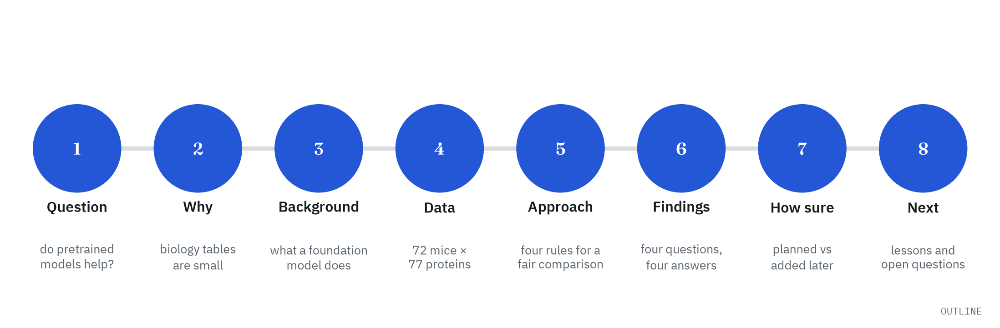
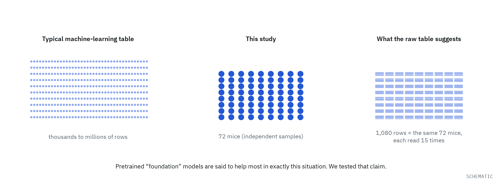
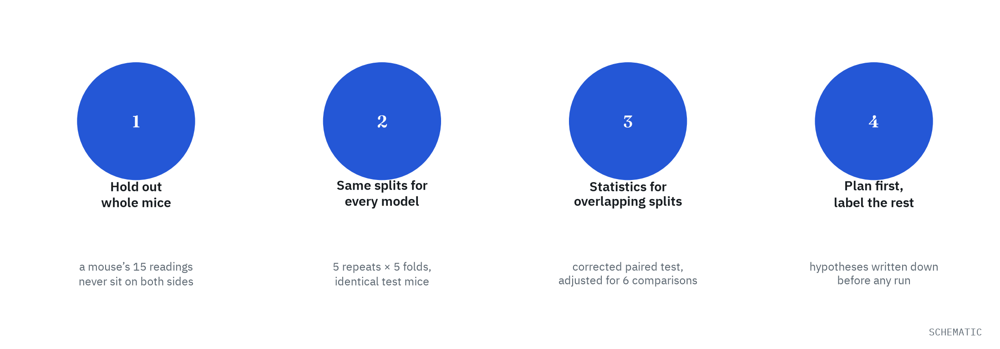
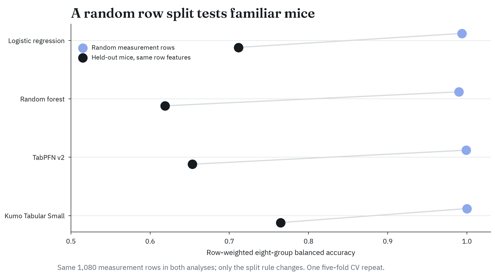
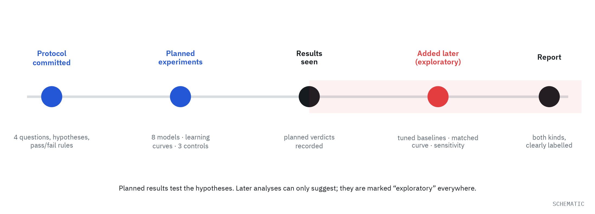
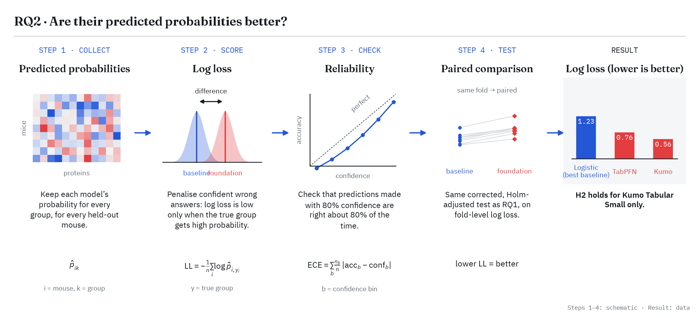
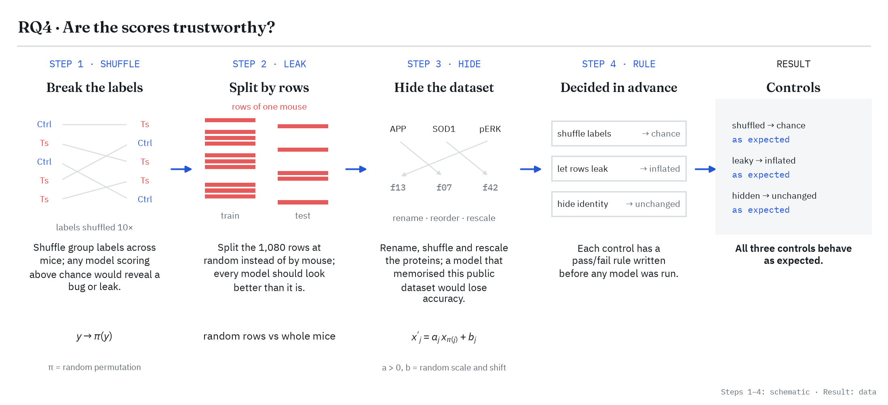
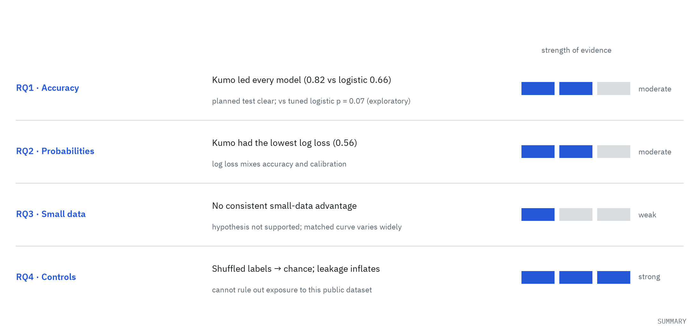

<!-- Generated from study_report.template.md by foundation_models/scripts/make_report.py.
     Edit the template, not study_report.md: $$Name placeholders are filled from results/. -->

## At a glance

New "foundation" models for tables are pretrained on millions of tables and are often said to
work best when data are scarce. We tested two of them, **TabPFN v2** and **Kumo Tabular
Small**, against six conventional models on a small biological dataset: 72 mice, 77 brain
proteins, 8 groups.

| Question | Short answer | How sure |
|---|---|---|
| **RQ1** More accurate? | Kumo led every model ($KumoBA vs $LogBA for logistic regression); its edge over a *tuned* logistic regression is not statistically clear | Moderate |
| **RQ2** Better probabilities? | Kumo had the lowest log loss ($KumoLL) | Moderate |
| **RQ3** Most helpful with the least data? | No; the planned hypothesis failed and a later matched curve varies widely | Weak |
| **RQ4** Can the scores be trusted? | All three controls behaved as expected | Strong |

## 1. The question

**Do tabular foundation models beat conventional models when there are only 72 samples?**

We split it into four questions, each with a hypothesis written down and committed *before*
any experiment ran.

| | Question | Hypothesis written in advance | Verdict |
|---|---|---|---|
| RQ1 | Are foundation models more accurate? | Each beats every conventional model | TabPFN: $HoneTabpfn; Kumo: $HoneKumo |
| RQ2 | Are their probabilities better? | Lower log loss than every conventional model | TabPFN: $HtwoTabpfn; Kumo: $HtwoKumo |
| RQ3 | Do they help most with the least data? | Bigger lead with 2 than with 6 mice per group | TabPFN: $HthreeTabpfn; Kumo: $HthreeKumo |
| RQ4 | Are the scores trustworthy? | Controls behave as expected | $HfourAll |

## 2. Why it matters

In biology every sample is an animal or a patient, so tables of tens to hundreds of samples
are normal. Foundation models are said to help most exactly here. Testing that claim fairly is
hard: few independent samples, noisy comparisons, and public data that a model may already
have seen.

## 3. Background in pictures

A conventional model learns from your training data only. A foundation model was trained once,
on millions of other tables, and then predicts new rows by reading your labeled rows as
*context*, in a single pass.

NVIDIA describes Kumo's pretraining tables as synthetic; that description does not apply
automatically to TabPFN.

**The line-up:** six conventional models (class prior, logistic regression, elastic net,
support-vector machine, random forest, gradient boosting) and two foundation models (TabPFN
v2 2.2.1 from Prior Labs; Kumo Tabular Small 0.3.0 from NVIDIA).

**Two scores:**

| Score | Meaning |
|---|---|
| Balanced accuracy | Average hit rate across the 8 groups; guessing gives 0.125 |
| Log loss | Penalty for confident wrong answers; lower is better |

## 4. The data

The data come from a study of the Ts65Dn mouse, a model of Down syndrome (UCI Machine Learning
Repository, <https://archive.ics.uci.edu/dataset/342/mice+protein+expression>). Three yes/no
choices (Ts65Dn or normal, learning task or not, drug or placebo) make **8 groups of 7–10
mice**.

> **The task:** given a new mouse's 77 protein levels, predict its group. Each mouse's 15
> readings are averaged into one profile, so there are **72 independent samples**.

## 5. Our approach

**Rule 1 in action.** Splitting rows instead of mice lets a model recognise mice it has
already seen, and every model looks nearly perfect.

**Rule 4 in action.** Everything added after the planned results were seen is labelled
*exploratory*.

## 6. What we found

Each question has two pictures: **how we answered it** (a workflow, read left to right) and
**the answer**.

### RQ1 · Is a foundation model more accurate?

**Planned test.** Kumo reached **$KumoBA** and beat all six conventional models; its lead over
logistic regression was $KumoLogDiff (p = $KumoLogP). TabPFN reached **$TabpfnBA**, but its
lead over logistic regression ($TabLogDiff, p = $TabLogP) could not be told apart from chance.
The simplest conventional model was the strongest.

**Exploratory.** With more thorough tuning, logistic regression improved to **$TunedLogBA**.
Kumo still scored highest, but its lead ($TunedDiff, 95% interval $TunedCI, p = $TunedP) was
no longer statistically clear. CatBoost and XGBoost were not tested.

### RQ2 · Are its probabilities better?

**Answer.** Kumo had the lowest log loss ($KumoLL, against $TabpfnLL for TabPFN and $LogLL for
logistic regression). Log loss mixes accuracy and calibration, and 72 mice are too few for a
precise calibration test, so we do not claim Kumo is better calibrated.

### RQ3 · Do they help most when data are scarcest?

**Planned test.** Models trained on 2 to 6 mice per group. Kumo's lead over logistic regression
was $KumoGapSmall at 2 mice per group and $KumoGapLarge at 6, so the hypothesis failed. The
test mice changed with training size, so this curve cannot isolate the effect of adding mice.

**Exploratory.** With test mice held fixed, Kumo scored $M16Kumo versus logistic regression's
$M16Log at 16 training mice, and $M48Kumo versus $M48Log at 48. The average lead grew, but
only 40 of 70 paired comparisons had a larger gap at 48 mice. There is no dependable
small-data pattern.

### RQ4 · Can the scores be trusted?

**Answer.** Shuffled labels gave near-chance accuracy; splitting rows inflated every model;
renaming, reordering and rescaling the proteins barely changed accuracy. The last check cannot
rule out exposure to this public dataset, because preprocessing may undo the transformations.

## 7. How sure we are

- **Informed versus blind.** The accuracy and probability hypotheses were written after an
  earlier benchmark on the same data had been seen, so they are informed rather than blind.
  The learning-curve hypothesis and the shuffled-label and leakage checks were blind.
- **Exploratory analyses** were designed after seeing the planned results; they suggest rather
  than confirm.
- **Ensemble size.** Both foundation models used 4 ensemble members (TabPFN's default is 8). At
  package defaults, TabPFN scored $EstTabpfnBA and Kumo $EstKumoBA, so the conclusions hold.
- One dataset and one cohort of male mice; results apply to the versions tested.

## 8. What it means and what's next

| Lesson | Why |
|---|---|
| Count independent units, not rows | Split by animal, patient or experiment |
| Compare against a well-tuned simple model | Logistic regression was hard to beat |
| Report probabilities; use corrected statistics | Fold-to-fold differences are not independent |
| Check for contamination, but know its limits | Hiding names and scales cannot prove a model never saw the data |

**Open questions:** stronger conventional baselines (CatBoost, XGBoost); newer model versions;
an independent cohort; and why Kumo and TabPFN differ.

## Where everything is

| What | Where |
|---|---|
| Full scientific paper | [Manuscript source](../paper/main.tex) ([PDF](../paper/main.pdf)) |
| Slides with speaker notes | [PowerPoint](../presentation/presentation.pptx) ([PDF](../presentation/presentation.pdf)) |
| Pre-specified protocol and later amendments | [Study protocol](../docs/study_protocol.md) |
| Long-form article | [Website article](../article.md) |
| All numbers | [Planned results](../results/summary.json), [exploratory results](../results/extension_summary.json) |
