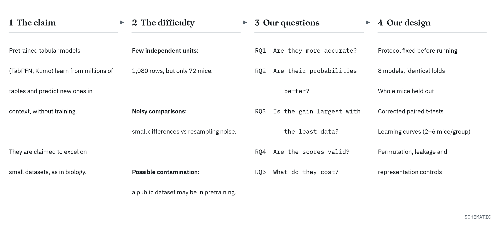
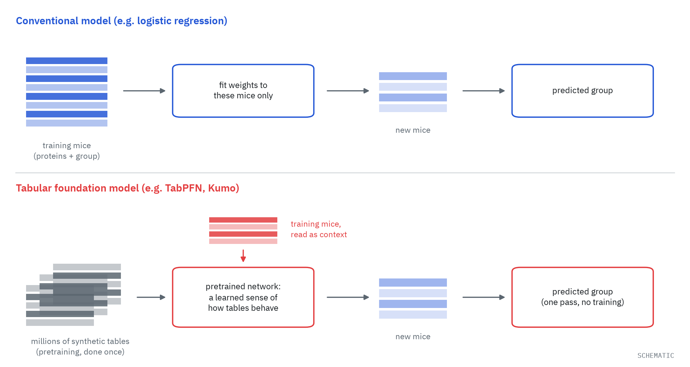
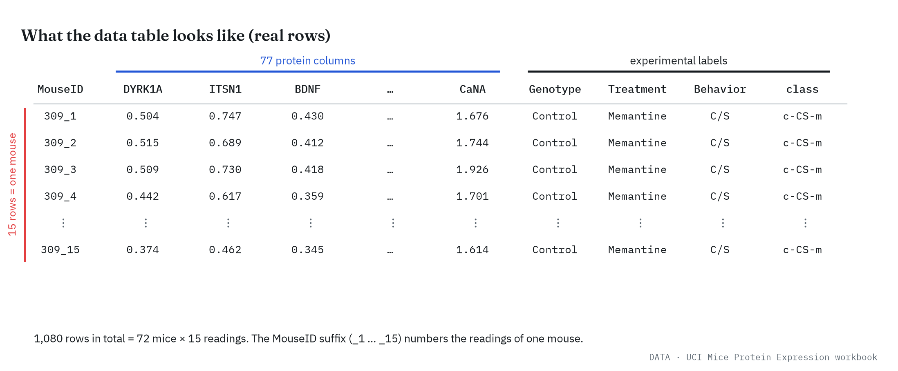
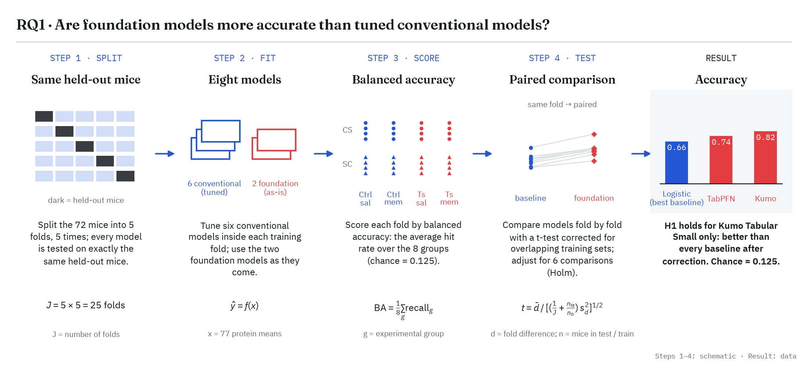
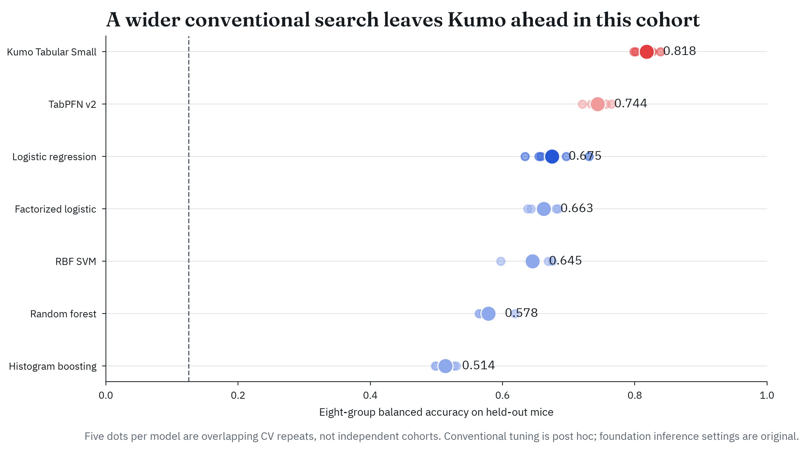
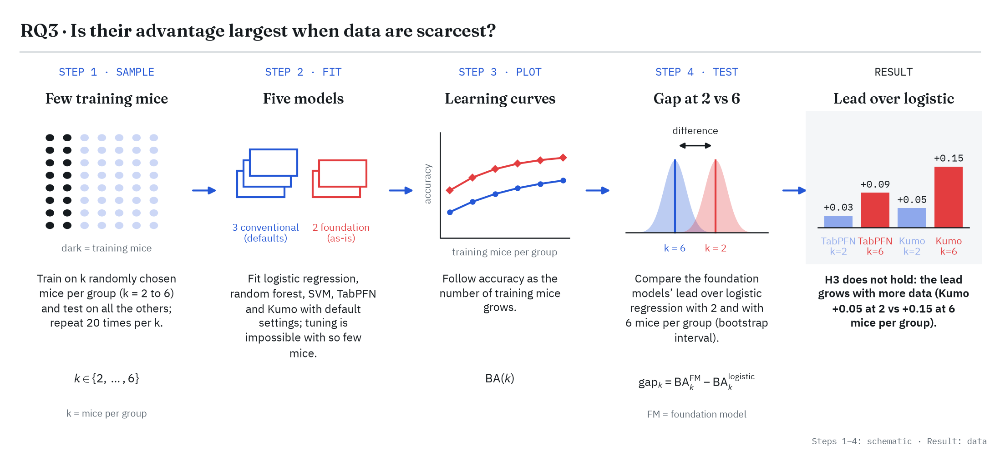
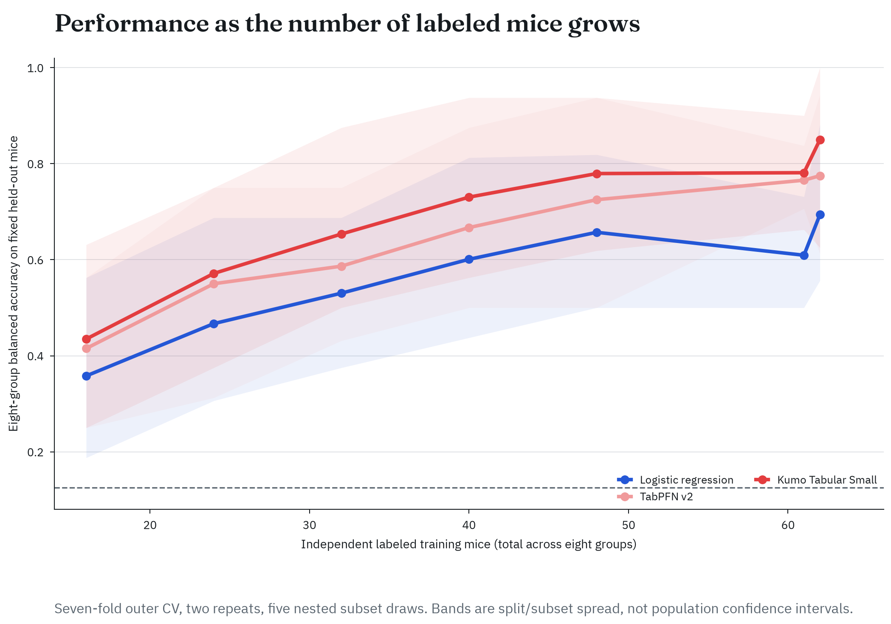
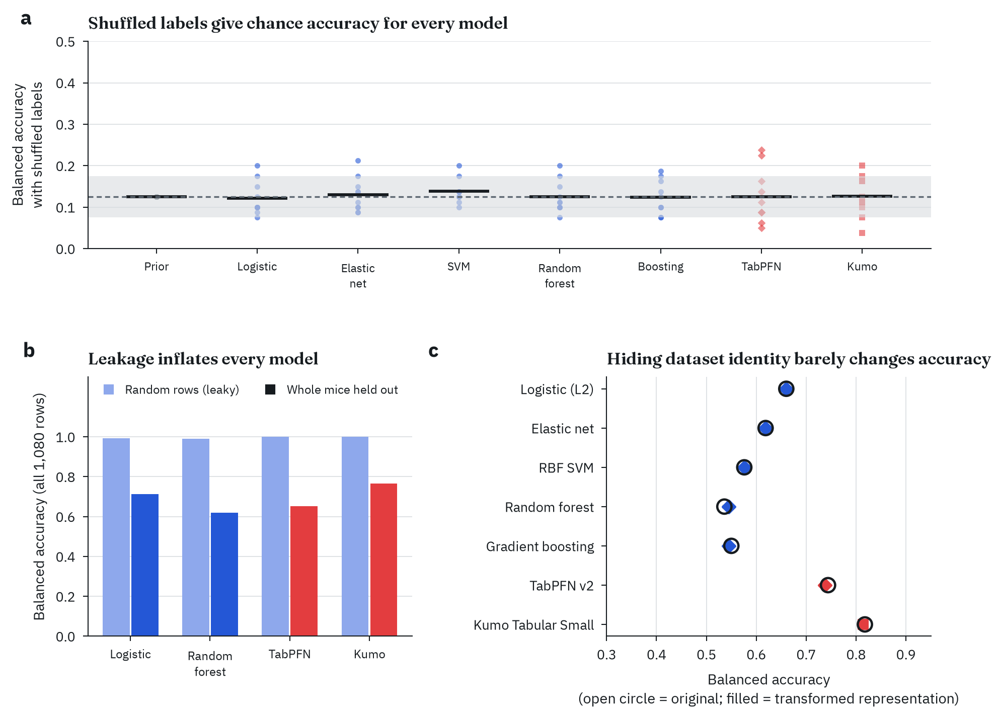

<!-- Generated from study_report.template.md by foundation_models/scripts/make_report.py.
     Edit the template, not study_report.md: $$Name placeholders are filled from results/. -->

## Summary

New "foundation" models for tables are pretrained on millions of tables and are often said to
work best when data are scarce. We tested two of them, TabPFN v2 and Kumo Tabular Small, against
six conventional models on a small biological dataset: 72 mice, 77 brain proteins, 8 groups.

- **Kumo was the most accurate model we tested** ($KumoBA balanced accuracy, against $TabpfnBA
  for TabPFN and $LogBA for logistic regression). In the comparison we planned in advance, it beat
  all six conventional models.
- **That lead is not settled.** In a later, exploratory comparison with a better-tuned logistic
  regression ($TunedLogBA), Kumo's lead of $TunedDiff was no longer statistically clear (95%
  interval $TunedCI; p = $TunedP).
- **TabPFN could not be told apart from plain logistic regression** in the planned test.
- **Kumo gave the best probabilities** (lowest log loss), although that alone does not prove its
  probabilities are calibrated.
- **The small-data pattern is uncertain.** In a later matched analysis, Kumo's average lead
  over logistic regression was larger with 48 than with 16 labeled mice, but varied widely
  between training-subset draws.
- **Pipeline checks behaved as expected:** shuffled labels gave near-chance accuracy and
  splitting measurement rows made scores look much better. These checks cannot establish
  generalization to another cohort or rule out pretraining contamination.

## 1. The problem

Most biological datasets are small, because every sample is an animal or a patient. A new class
of models promises to help: **tabular foundation models**. Instead of learning only from your
data, they bring knowledge from pretraining on millions of tables. Their developers report strong
results on small datasets.

Testing that promise on real biological data is harder than it looks:

1. **Rows are not samples.** Our table has 1,080 rows but only 72 mice; each mouse was measured
   15 times. Mixing a mouse's measurements between training and testing makes every model look
   almost perfect.
2. **Small samples make comparisons noisy.** With 72 mice, a difference of a few percentage
   points between models can easily be chance.
3. **Public data may already be memorised.** The dataset is public, so a pretrained model might
   have seen it.

## 2. Background you need

*How to read this figure:* a conventional model (top) learns from your training data only. A
foundation model (bottom) brings prior training on other tables; it uses your labeled mice as
context to predict new ones. NVIDIA describes Kumo's pretraining tables as synthetic. This
description does not apply automatically to TabPFN's pretraining data.

| Term | Meaning |
|---|---|
| Balanced accuracy | The average hit rate across the 8 groups. Guessing gives 0.125 |
| Log loss | A penalty for confident wrong answers; lower is better |
| Leakage | Test information reaching the model during training |
| Pre-specified | Written down before any experiment was run |
| Exploratory | Added after seeing the results: useful, but not a confirmation |

## 3. The data

The data come from a study of the Ts65Dn mouse, a model of Down syndrome (UCI Machine Learning
Repository, <https://archive.ics.uci.edu/dataset/342/mice+protein+expression>). Mice were either
Ts65Dn or normal, did or did not go through a learning task, and received a drug (memantine) or a
placebo. That gives **8 groups of 7–10 mice**. Seventy-seven proteins were measured in each
mouse's brain.

The models' task: **given a new mouse's 77 protein levels, predict its group.** We averaged each
mouse's 15 measurements into one profile, so every model is always tested on mice it has never
seen.

## 4. Our questions

Each question had a hypothesis that we wrote down and saved before running anything.

| | Question | Hypothesis | Verdict |
|---|---|---|---|
| RQ1 | Are foundation models more accurate? | Each beats every conventional model | TabPFN: $HoneTabpfn; Kumo: $HoneKumo |
| RQ2 | Are their probabilities better? | Lower log loss than every conventional model | TabPFN: $HtwoTabpfn; Kumo: $HtwoKumo |
| RQ3 | Do they help most with the least data? | Bigger lead with 2 than with 6 mice per group | TabPFN: $HthreeTabpfn; Kumo: $HthreeKumo |
| RQ4 | Are the scores trustworthy? | Controls behave as expected | $HfourAll |

## 5. How we tested them

- **Hold out whole mice.** A mouse's measurements are never split between training and testing.
- **Same test mice for every model.** We split the 72 mice into five parts, five different ways,
  and gave every model exactly the same splits.
- **Statistics that respect overlapping splits.** A corrected paired test, adjusted for comparing
  one model against six others.
- **Planned versus later analyses kept apart.** Everything added after seeing results is marked
  *exploratory*.

*How to read this figure:* each line connects a model's accuracy when whole mice are held out
(dark) with its accuracy when rows are split at random (light). The random split lets the model
recognise mice it has already seen.

## 6. What we found

### RQ1 · Accuracy

In the planned comparison, Kumo reached **$KumoBA** and beat all six conventional models; its lead
over logistic regression was $KumoLogDiff (p = $KumoLogP). TabPFN reached **$TabpfnBA**, but its
lead over logistic regression ($TabLogDiff, p = $TabLogP) could not be told apart from chance.
Notably, the simplest conventional model was the strongest one.

*Exploratory:* when we later tuned the conventional models more thoroughly, logistic regression
improved to **$TunedLogBA**. Kumo still scored highest, but its lead ($TunedDiff, 95% interval
$TunedCI, p = $TunedP) was no longer statistically clear. We could not test CatBoost or XGBoost,
two strong conventional methods.

### RQ2 · Probability quality

Kumo had the lowest log loss ($KumoLL, against $TabpfnLL for TabPFN and $LogLL for logistic
regression): its probabilities were the most useful. Log loss mixes accuracy and calibration,
and 72 mice are too few for a precise calibration test, so we do not claim Kumo is better
calibrated.

### RQ3 · Does the advantage shrink or grow with data?

In the original analysis, models trained on 2 to 6 mice per group. Its estimated Kumo lead
over logistic regression was $KumoGapSmall at 2 mice per group and $KumoGapLarge at 6.
The test mice changed with training size, so that curve cannot isolate the effect of adding
labeled mice. Its prespecified hypothesis verdict is an audit of that original analysis,
not a reliable conclusion about sample efficiency.

*Exploratory:* the later curve kept test mice fixed and repeated the matched training-subset
draw five times per outer split. With 16 training mice, Kumo scored $M16Kumo versus logistic
regression's $M16Log; with 48, $M48Kumo versus $M48Log. The average lead grew, but only 40 of
70 paired subset comparisons had a larger gap at 48 mice. These are repeated uses of one
cohort, not independent biological replications or evidence of a reliable threshold.

### RQ4 · Can the scores be trusted?

*How to read this figure:* (a) with shuffled labels every model scores near chance; (b) splitting rows
instead of mice inflates every model; (c) renaming, reordering and rescaling the proteins barely
changes accuracy (open circle = original, filled = transformed). The last check cannot rule out
exposure to this public dataset: preprocessing may undo the transformations. NVIDIA reports
synthetic-only pretraining for Kumo.

## 7. What this means

- **For scientists using these models:** split by animal or patient, compare against a well-tuned
  simple model, report probabilities, and use statistics that account for overlapping splits.
- **For the "small-data" claim:** the matched curve does not establish that either model has
  a consistent relative advantage at any particular training size.
- **For choosing a model:** Kumo was the best model we tested here, but this does not establish
  that it beats every conventional approach.

## 8. Limitations

- One dataset and one cohort of male mice; no independent test cohort.
- Results apply to the specific versions tested (TabPFN v2, Kumo Tabular Small 0.3.0).
- CatBoost and XGBoost were not tested.
- Analyses marked exploratory were designed after seeing the planned results.
- The accuracy and probability hypotheses were written after an earlier benchmark on the same
  data had already been seen, so they are informed rather than blind tests. The learning-curve
  hypothesis and the shuffled-label and leakage checks were blind.
- Both foundation models used 4 ensemble members; TabPFN's own default is 8. A later check at
  package defaults gave $EstTabpfnBA for TabPFN and $EstKumoBA for Kumo, so the conclusions do
  not depend on this choice.

## 9. Where everything is

| What | Where |
|---|---|
| Full scientific paper | [Manuscript source](../paper/main.tex) ([PDF](../paper/main.pdf)) |
| Slides with speaker notes | [PowerPoint](../presentation/presentation.pptx) ([PDF](../presentation/presentation.pdf)) |
| Pre-specified protocol and later amendments | [Study protocol](../docs/study_protocol.md) |
| Long-form article | [Website article](../article.md) |
| All numbers | [Planned results](../results/summary.json), [exploratory results](../results/extension_summary.json) |
