<!-- Generated from report/study_report.template.md by scripts/make_report.py.
     Edit the template, not study_report.md: $Name placeholders are filled from results/. -->

## Summary

A public dataset of brain proteins from a Down syndrome mouse model is widely used to test
machine-learning methods. We analysed it as the biological experiment it is and found the
following.

- **The usual benchmark is misleading.** The data hold 1,080 measurements but only 72
  mice. Counting measurements as mice inflates classification accuracy from 0.602 to
  0.994.
- **Q1 · Attenuated measured dosage effect.** Across six selected proteins from triplicated
  genes, the mean observed log₂ difference is about 23% of the simple 1.5-fold
  expectation *on the log₂ scale*. This does not characterize all triplicated genes.
- **Q2 · A weaker conditioning-associated signature.** The untreated trisomic estimate is
  smaller; the treated estimate is near the control reference, with substantial uncertainty.
- **Q3 · Possible shift toward control.** The estimated rescue fraction is 64%, with
  a wide bootstrap interval (-0.01 to 1.71); its magnitude and specificity remain uncertain.
- **Q4 · No detected covariance difference.** This analysis did not detect a difference in
  residual protein correlations; power to detect modest changes is limited.

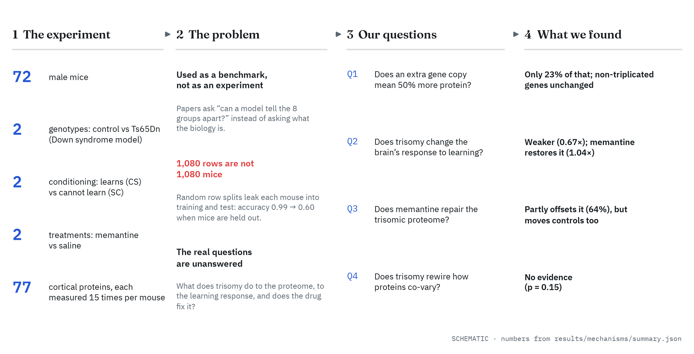

## 1. The problem

**What the data are.** In 2015 a research team measured 77 proteins in the brains of 72 mice.
Some mice model Down syndrome, some had learned to fear a place, and some received a drug. They
published the data in the UCI Machine Learning Repository
(<https://archive.ics.uci.edu/dataset/342/mice+protein+expression>) so that others could
analyse them.

**How the data have been used.** Most later work treats the dataset as a puzzle for algorithms:
given a mouse's protein levels, can a model guess which of the eight groups it came from?

**What is wrong with that.**

1. *It overstates accuracy.* Each mouse was measured 15 times. When the measurements are split
   at random into training and test data, the same mouse appears in both, and the model can
   score well by recognising individual mice rather than learning the biology.
2. *It answers the wrong question.* Even an accurate classifier tells us only that the groups
   differ. It does not tell us *how* they differ, which is what the experiment was designed to
   find out.

**Why it matters.** Down syndrome is the most common genetic cause of intellectual disability.
Knowing what an extra chromosome does to brain proteins, and whether a drug can undo it, is
the kind of evidence that guides treatment research.

## 2. Background you need

| Term | What it means here |
|---|---|
| **Down syndrome** | Caused by an extra copy of human chromosome 21 |
| **Ts65Dn mouse** | Carries an extra copy of about 90 genes that are also on human chromosome 21; widely used to model Down syndrome |
| **Fear conditioning** | A memory test. **CS** mice explore a box and then receive a mild shock, so they learn to fear the box. **SC** mice are shocked immediately and cannot link the shock to the box. Comparing CS with SC isolates the effect of learning |
| **Memantine** | A drug that blocks NMDA receptors, a type of receptor involved in memory. Earlier work showed it restores learning in Ts65Dn mice |
| **The experiment** | 2 genotypes × 2 conditioning types × 2 treatments = 8 groups of 7–10 mice; 77 proteins measured in the cortex |

### How the experiment worked

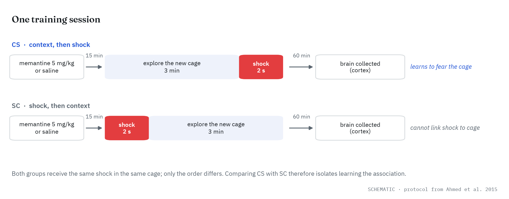

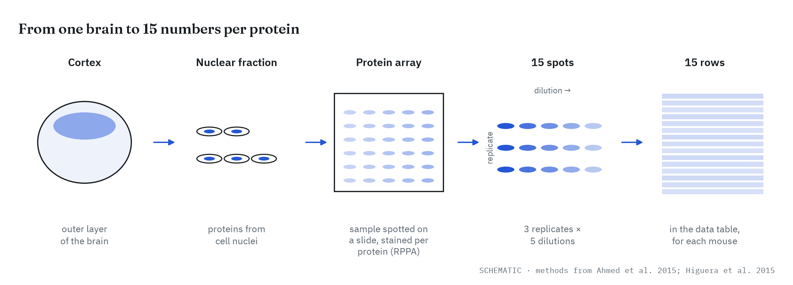

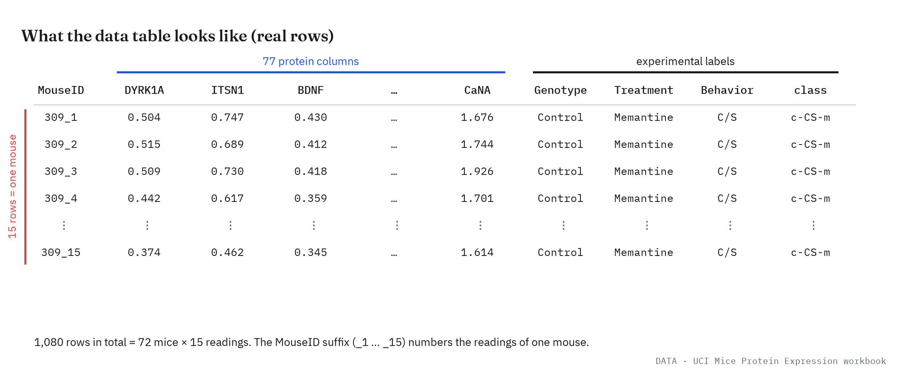

## 3. Our questions

| | Question | Why it matters |
|---|---|---|
| **Q1** | Do three copies of a gene give 1.5 times as much protein? | Tests the simplest explanation of trisomy |
| **Q2** | Does trisomy change the brain's protein response to learning? | Links molecules to the known learning deficit |
| **Q3** | Does memantine move the trisomic brain back toward normal? | Asks how the drug works |
| **Q4** | Does trisomy change how proteins work together? | Effects may lie in coordination, not in levels |

## 4. How we answered them

| Step | What we did | Why |
|---|---|---|
| 1. Count mice, not rows | Averaged each mouse's 15 measurements into one value per protein | Measurements of the same mouse are not independent |
| 2. Check the data | Found that the 15 measurements form five technical blocks of three, removed one duplicated column, and checked that missing values are random | Problems in the data would distort every result |
| 3. Build signatures | Combined proteins into a single score per mouse that captures one effect, such as learning or trisomy | One score per mouse is far more reliable with 7–10 mice per group than 77 separate tests |
| 4. Avoid self-flattery | Scored each mouse on a signature rebuilt without that mouse | A mouse that helped define a signature would look artificially typical on it |
| 5. Measure uncertainty | Re-drew mice 4,000 times (bootstrap) and shuffled group labels 5,000 times (permutation tests) | Shows how much results could change by chance |
| 6. Test the tools | Checked every shortcut against a slow, exact version or a simulation with a known answer | Ensures the method works before it touches real data |

## 5. What we found

### First: why the benchmark misleads

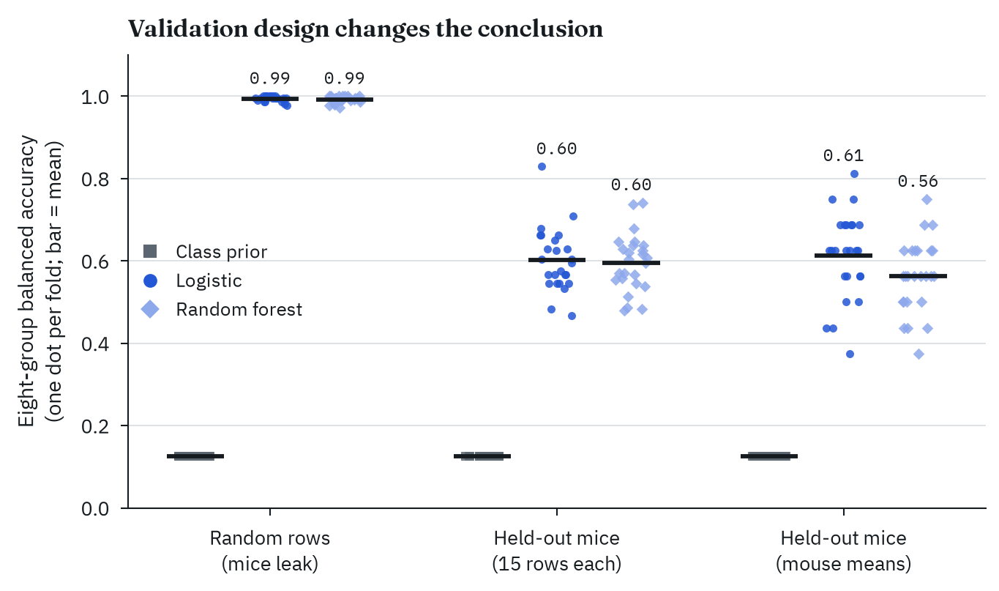

*How to read this figure:* each dot is one test of a classifier. The left group splits rows at
random; the other two hold out whole mice. The dashed line is chance (1 in 8).

When the same mouse can appear in training and test data, accuracy is almost perfect
(0.994). When whole mice are held out, it falls to 0.602. The near-perfect scores often
reported for this dataset mostly measure recognition of individual mice.

### Q1 · Do three gene copies give 1.5 times as much protein?

**Short answer:** across six measured proteins, the mean log₂ difference is about
23% of the simple dosage expectation on the log₂ scale.

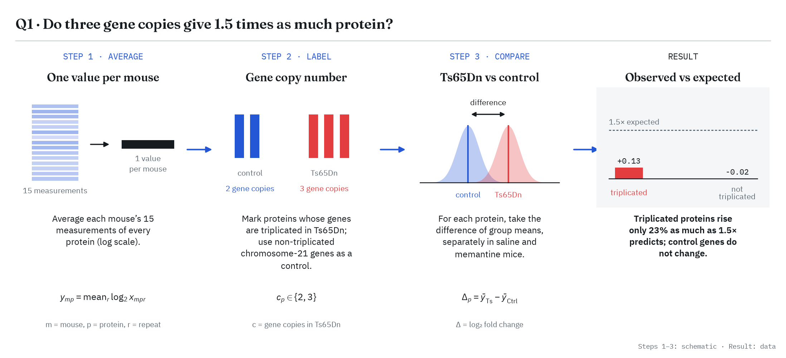

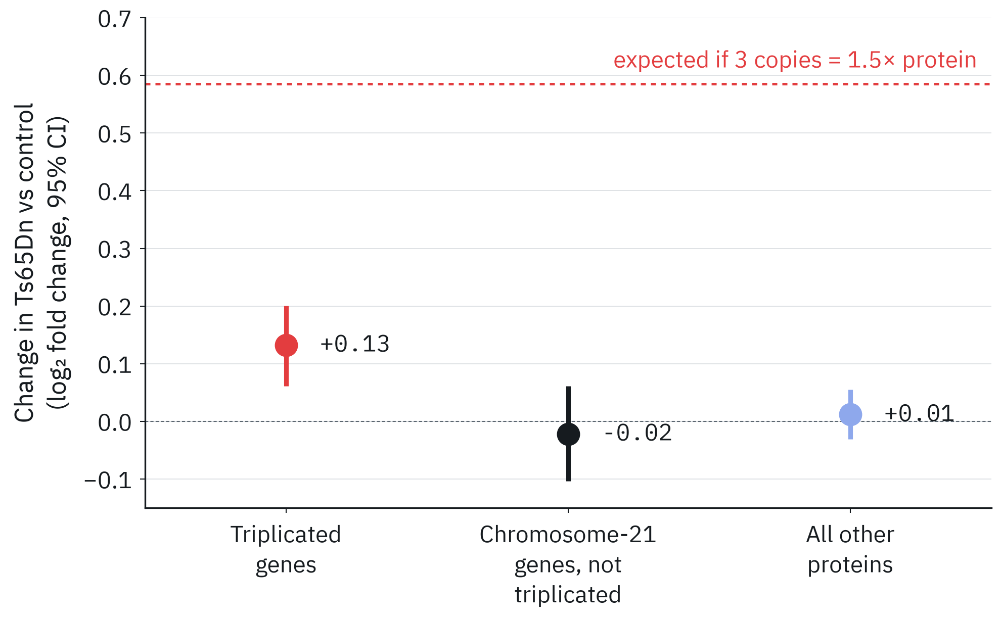

*How to read this figure:* each point is the average change (with 95% interval) for a group of
proteins. The dashed red line is where triplicated genes would sit if three copies meant 1.5
times the protein.

The six proteins from triplicated genes rose by 1.10-fold on average (95% interval
0.06–0.20 on the log₂ scale). Two genes that are on human chromosome 21 but *not*
triplicated in this mouse did not show a detectable change (-0.02), a pattern consistent
with copy number. Estimates from two separate groups of mice agreed (r = 0.66).

**Caveat:** the shortfall could come from the measurement method compressing large differences,
from measuring only the cell nucleus, or from cells compensating for the extra copies. These
data cannot tell these explanations apart.

### Q2 · Does trisomy change the brain's response to learning?

**Short answer:** the untreated trisomic estimate is lower; the treated estimate is near the
control reference, without establishing equivalence or complete restoration.

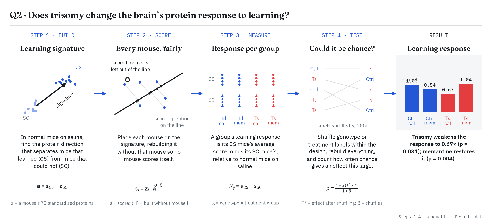

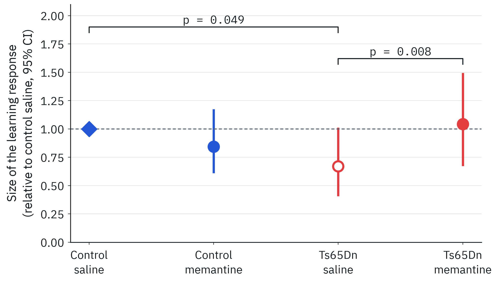

*How to read this figure:* 1.0 is the response of normal mice on saline. Points below 1 are
weaker responses. Brackets show permutation tests.

We defined a *learning signature* as the protein difference between mice that learned (CS) and
mice that could not (SC), using normal mice on saline. Measured on that signature, trisomic
mice on saline responded at **0.67** times the normal level (95% interval
0.41–1.01; p = 0.031). With memantine they responded at **1.04** times
(p = 0.004 for the within-analysis contrast). This shared-axis analysis measures the
projection of each group on a signature defined in control mice; it cannot establish that
exactly the same proteins respond in every group. Earlier behavioral work found that
memantine improved task performance, but this dataset has no per-mouse learning outcome.

**Caveat:** the dataset has no learning score for each mouse, so the link to behaviour holds at
the group level only. The upper end of the interval is close to 1, so this result needs
replication.

### Q3 · Does memantine move the trisomic brain back toward normal?

**Short answer:** the point estimate suggests a shift toward the control reference, but its
magnitude and specificity are uncertain.

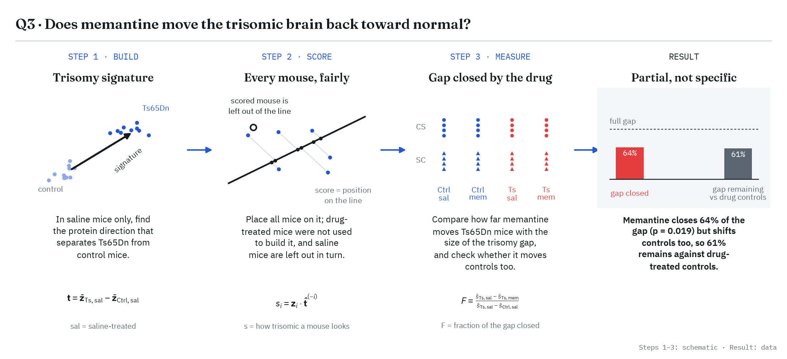

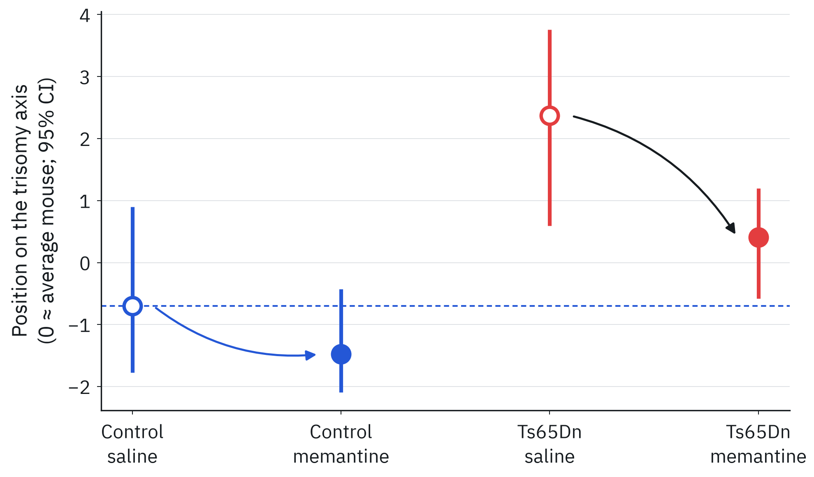

*How to read this figure:* the vertical axis measures how "trisomic" a group's protein profile
looks. Arrows show the effect of memantine within each genotype.

The estimated shift was 64% of the untreated trisomy gap (bootstrap interval
-0.01 to 1.71; p = 0.019 under the specified analysis). The interval includes no rescue and
values beyond complete closure of the constructed signature gap. A shift in control mice was
also estimated, but its uncertainty prevents a firm claim that the drug effect is nonspecific.
Compared with treated control mice, 61% of the signature difference remains as a point
estimate.

**A trap we avoided.** A tempting shortcut is to pick the proteins most changed by trisomy and
then check whether the drug "fixes" them in the same mice. That makes rescue look larger than it
is, through regression to the mean. We measured the two effects in separate mice instead.

### Q4 · Does trisomy change how proteins work together?

**Short answer:** this analysis did not detect a difference.

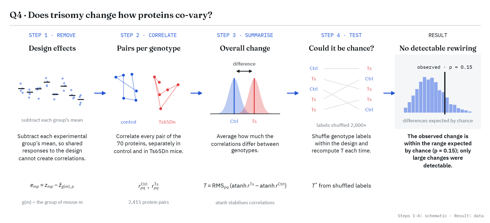

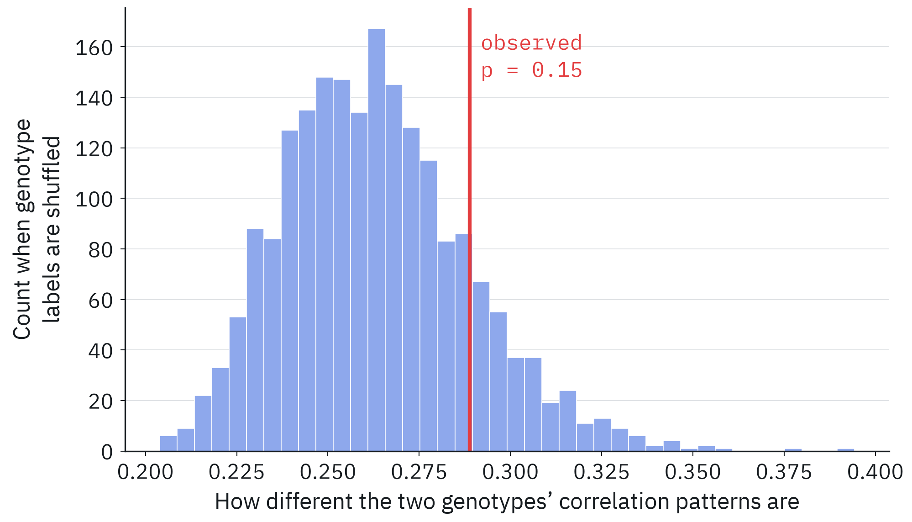

*How to read this figure:* the blue bars show the differences expected by chance, obtained by
shuffling genotype labels. The red line is the observed difference. It falls within the chance
range (p = 0.15).

**Caveat:** with about 34 mice per genotype only large changes would be visible, so this result
is inconclusive rather than a proof of no effect.

## 6. What this means and what comes next

- **For researchers using this dataset:** split by mouse, never by row.
- **For Down syndrome biology:** the conditioning-associated signature may be attenuated in
  untreated trisomic mice and larger after memantine. This is a hypothesis to test in an
  independent cohort with per-mouse learning outcomes.
- **For drug research:** this dataset does not establish complete restoration or a
  trisomy-specific effect.
- **For the next experiment:** about 10 mice per group would confirm the learning
  result with 80% power. Single-protein interaction effects would need 16–64
  mice per group. Include female mice, an independent cohort and per-mouse learning scores.

## 7. Limitations

- One laboratory, one measurement method, male mice only, and no independent replication.
- CS and SC differ in timing as well as in learning, so the learning signature also contains
  protocol differences.
- The replicate and dilution structure is inferred from the data, not documented.
- The original publication describes two cortical print runs, but print-run identifiers are
  unavailable here; batch-related confounding cannot be excluded.
- Signature axes omit the scored mouse, but pooled within-cell standardization was computed
  from all mice using labels. Thus these scores are not fully out-of-sample, and permutation
  results are conditional on that observed standardization.

## 8. Glossary

| Term | Meaning |
|---|---|
| Balanced accuracy | Average of the accuracies for each group; 0.125 is chance for 8 groups |
| Bootstrap | Re-drawing mice with replacement many times to measure uncertainty |
| Confidence interval (95%) | A range of values compatible with the data |
| False discovery rate (q) | The expected share of false positives among findings reported as significant |
| log₂ fold change | A ratio on a doubling scale: 1 means double, −1 means half, 0.58 means 1.5 times |
| p-value | How often chance alone would give a result at least this extreme |
| Permutation test | Shuffling group labels to see how often chance produces an effect this large |
| Signature | A weighted combination of proteins that captures one effect |

## 9. Where everything is

| What | Where |
|---|---|
| Full scientific paper | `paper/main.pdf` |
| Slides with speaker notes | `presentation/presentation.pptx` (and `.pdf`) |
| Every decision and its rationale | `docs/analysis_decisions.md` |
| All numbers | `results/mechanisms/summary.json` and the `results/` tables |
| Reproduce everything | `make install && make reproduce` |
