<!-- Generated from report/study_report.template.md by scripts/make_report.py.
     Edit the template, not study_report.md: $$Name placeholders are filled from results/. -->

## At a glance

We measured how 77 brain proteins differ between mice that carry extra copies of Down-syndrome
genes and normal mice, while they learn and after a drug called memantine. The data are public
(UCI Machine Learning Repository,
<https://archive.ics.uci.edu/dataset/342/mice+protein+expression>).

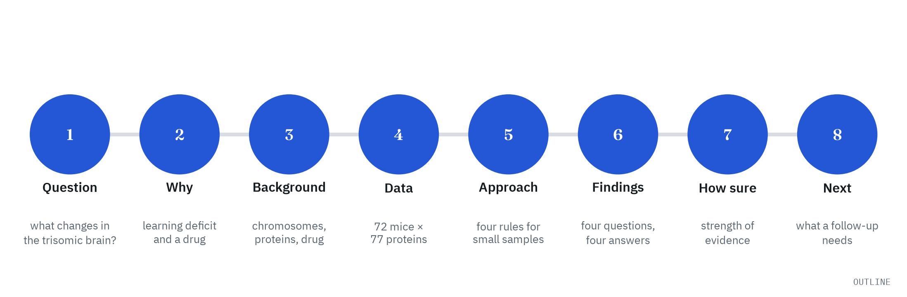

| Question | Short answer | How sure |
|---|---|---|
| **Q1** Do extra gene copies make extra protein? | Yes, but only about $DosageFrac% of what the extra copies predict | Strong |
| **Q2** Does trisomy change the brain's response to learning? | It looks weaker ($LearnRelTsSal× normal) and near normal with memantine | Weak |
| **Q3** Does memantine move trisomic mice back toward normal? | Possibly ($RescueFrac% of the gap), but by a very uncertain amount | Weak |
| **Q4** Does trisomy rewire how proteins work together? | No difference detected; only large changes were detectable | Weak |

One practical lesson applies to anyone who uses this dataset: **count mice, not rows.** The
table has $NRows rows but only $NMice mice; treating rows as mice inflates prediction accuracy
from $GroupedBA to $RowBA.

## 1. The question

**What changes in the brain's proteins when a mouse carries extra copies of Down-syndrome
genes, while it learns and after the drug memantine?**

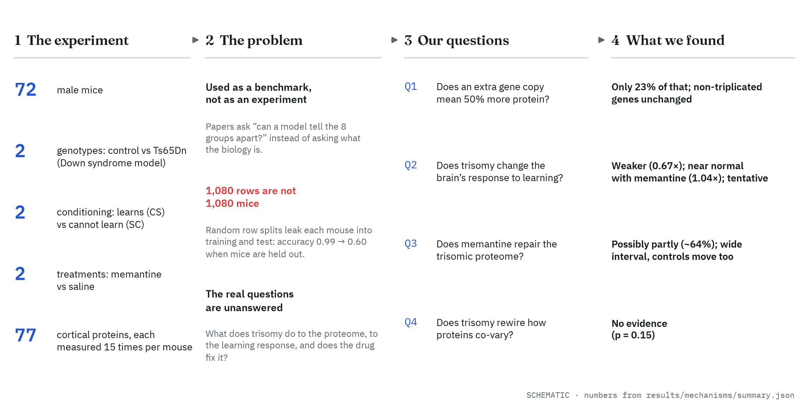

## 2. Why it matters

Down syndrome is the most common genetic cause of intellectual disability. Two facts are
already known:

- A mouse model carrying extra copies of the same genes **fails a simple memory test**.
- The drug **memantine restores the mice's learning** in earlier behavioural experiments.

What happens to brain proteins between the extra genes and the behaviour is still unclear.
Proteins are where that missing step can be measured.

## 3. Background in pictures

Four ideas are enough to follow the rest of the report.

**Idea 1 · The mouse model.** People with Down syndrome have three copies of chromosome 21.
Ts65Dn mice carry an extra piece of mouse chromosome 16 with about 90 of the same genes.

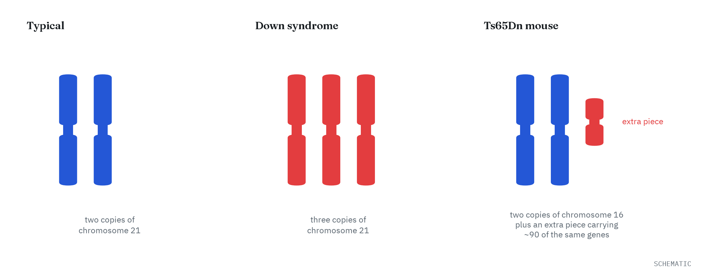

**Idea 2 · Proteins.** Genes are recipes; proteins are the machines they make. Many proteins
are switched on by a small chemical tag (phosphorylation). Protein names that start with *p*,
such as pERK, are the tagged forms.

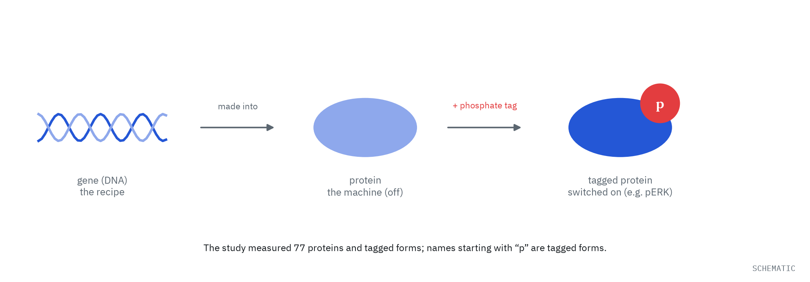

**Idea 3 · The memory test.** Mice learn to fear a cage only if the shock comes *after* they
explore it (CS). Mice shocked first (SC) receive the same shock but cannot make the link. CS
minus SC therefore isolates learning.

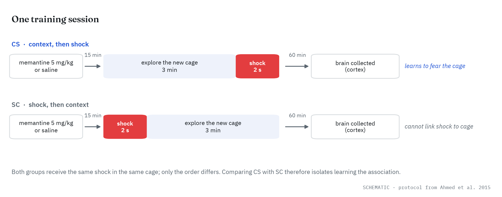

**Idea 4 · The drug.** Memantine partly blocks the NMDA receptor, a channel that drives the
signalling behind memory. It is an approved Alzheimer's drug.

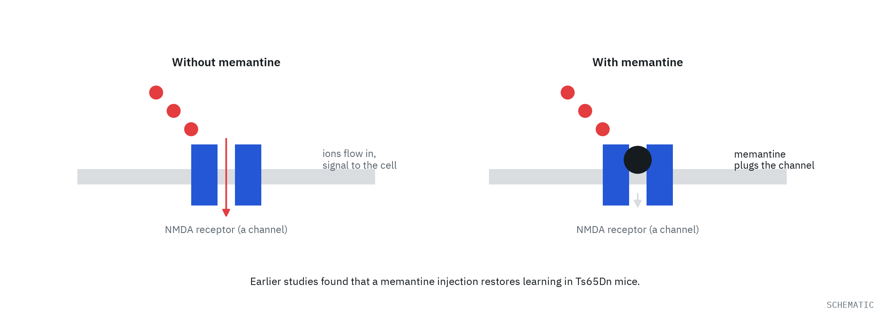

## 4. The data

Three yes/no choices make **eight groups of 7–10 mice**: Ts65Dn or normal, CS or SC training,
memantine or saline. Brains were collected one hour after training and 77 proteins were
measured in the cortex.

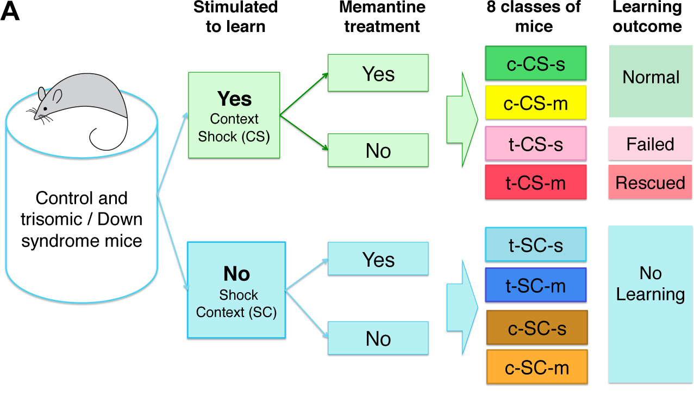

Each brain sample was measured **15 times** (3 replicates × 5 dilutions), so every mouse fills
15 rows of the table.

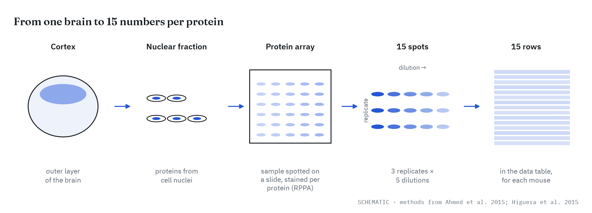

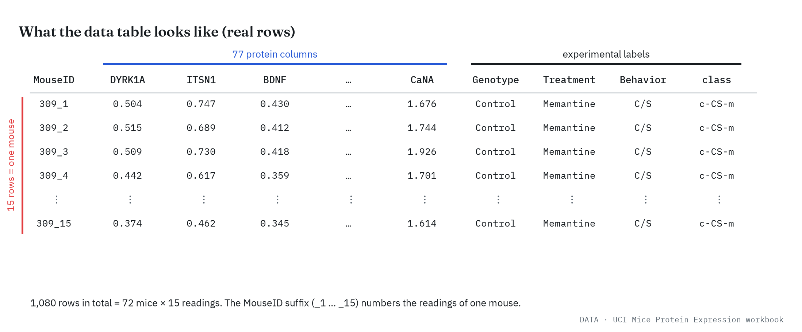

> **Key fact:** $NRows rows, but only **$NMice independent mice**. Every analysis below uses
> one value per mouse.

**What these data cannot tell us:** which individual mouse learned (no per-mouse memory score
was recorded); cause and effect for single proteins; anything about females, other ages or
other brain regions.

## 5. Our approach

Seventy-two mice is a small sample. Four rules keep the answers trustworthy.

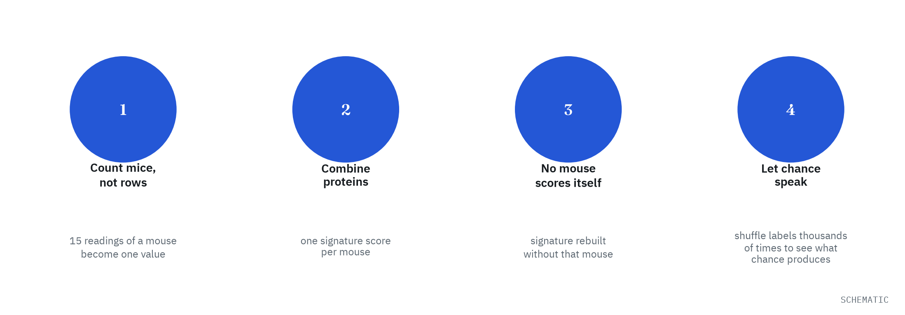

**Rule 1 in action.** When rows are split at random, the same mouse sits in both training and
test data, and a classifier learns to recognise mice rather than groups.

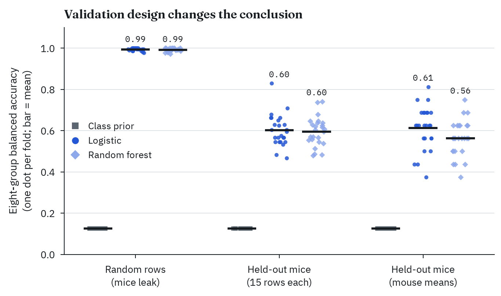

**Rule 2 in action.** With 7–10 mice per group, 70 separate protein tests are noisy. A
*signature* combines the proteins into one score per mouse for each effect.

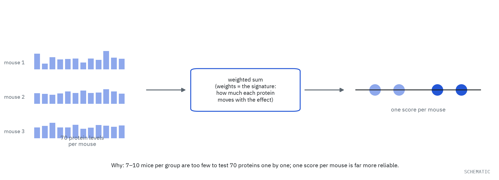

Rules 3 and 4: each mouse is scored on a signature rebuilt without it, and chance is measured
by re-drawing mice $NBoot times (bootstrap) and shuffling labels $NPerm times within the design
(permutation tests). Every shortcut was checked against an exact calculation or a simulation.

## 6. What we found

Each question has two pictures: **how we answered it** (a workflow, read left to right) and
**the answer** (the measured result).

### Q1 · Do extra gene copies make extra protein?

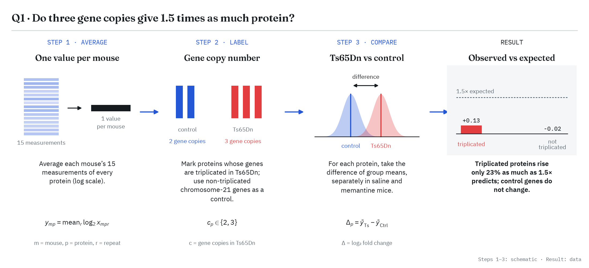

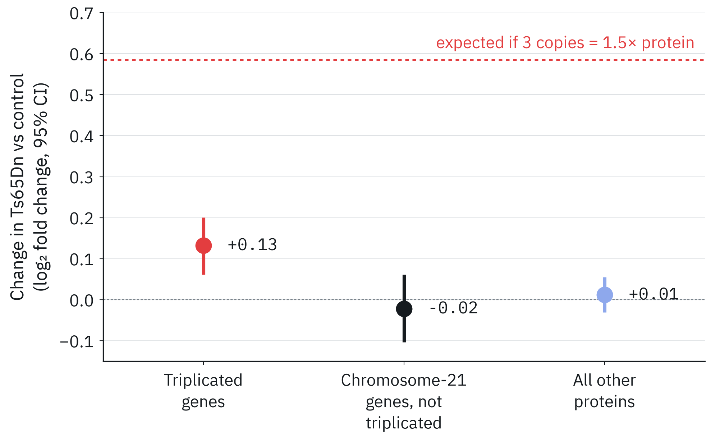

**Answer.** Six proteins from triplicated genes rose by $DosageFold-fold on average (95%
interval $DosageTriCI on the log₂ scale), about **$DosageFrac% of the simple 1.5-fold
expectation**. Two chromosome-21 genes that are *not* triplicated in this mouse did not change
($DosageDis), as copy number predicts. Two separate groups of mice agreed (r = $DosageRep).

**Why it might fall short:** cells may compensate for the extra copies, or the measurement may
compress large differences. These data cannot tell the two apart.

### Q2 · Does trisomy change the brain's response to learning?

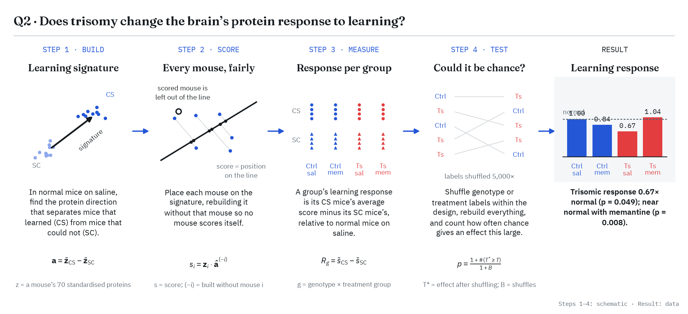

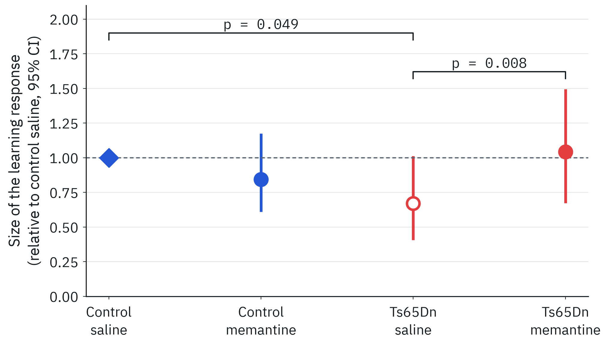

**Answer.** On a learning signature defined in normal mice, trisomic mice on saline responded
at **$LearnRelTsSal× the normal level** (95% interval $LearnRelTsSalCI; p = $LearnAttP). With
memantine they responded at **$LearnRelTsMem×** (p = $LearnResP).

**Caveat:** the interval nearly reaches 1, and the link to behaviour holds only at the group
level, because no per-mouse learning score exists. This needs replication.

### Q3 · Does memantine move trisomic mice back toward normal?

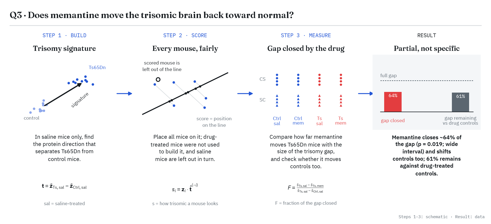

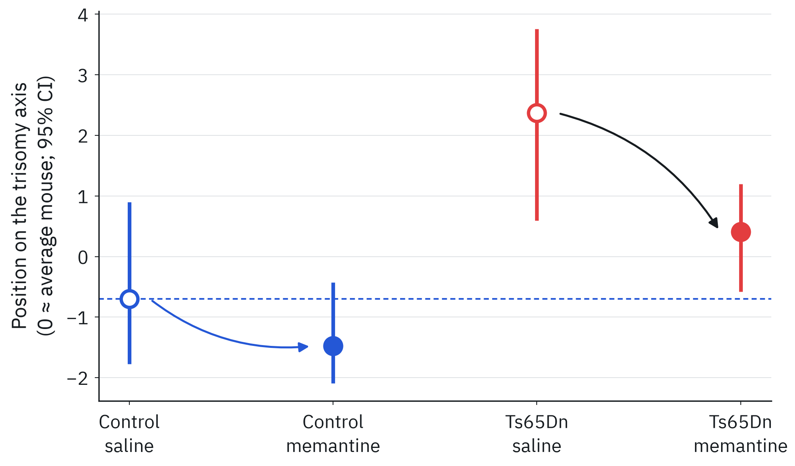

**Answer.** Memantine shifted trisomic mice about **$RescueFrac%** of the way toward normal
(bootstrap interval $RescueFracCI; p = $RescueP). The interval runs from no shift to beyond a
full return, and normal mice also shifted, so neither the size nor the specificity is settled.
Against drug-treated normal mice, $Persist% of the difference remains.

**A trap we avoided:** picking the proteins most changed by trisomy and then checking whether
the drug "fixes" them in the same mice exaggerates rescue (regression to the mean). We
measured the two effects in separate mice.

### Q4 · Does trisomy rewire how proteins work together?

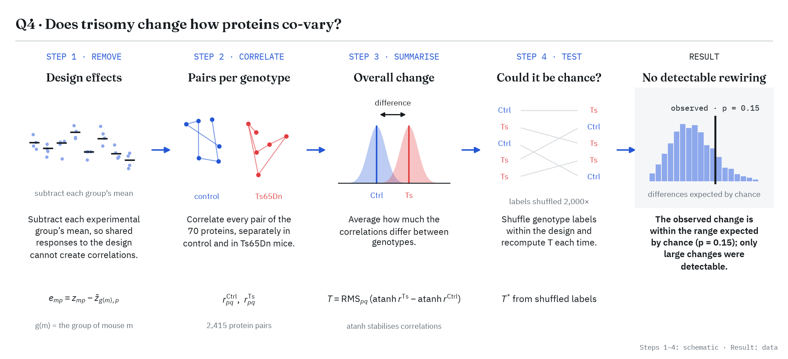

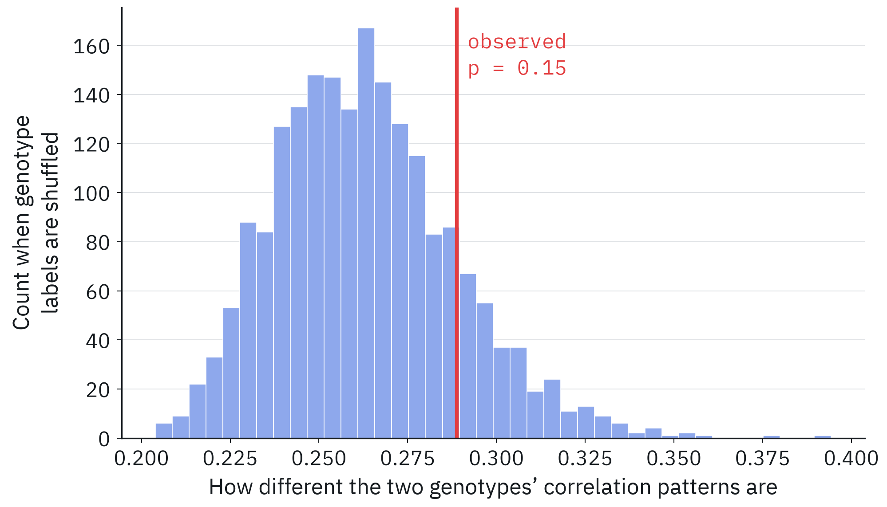

**Answer.** No difference was detected (p = $NetP). With about 34 mice per genotype only large
changes would be visible, so this is inconclusive rather than proof of no effect.

## 7. How sure we are

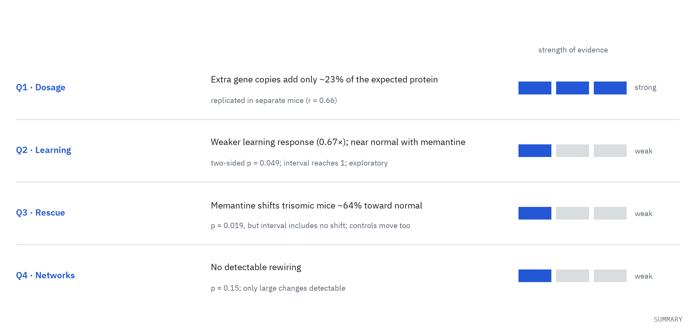

- **The p-values are exploratory.** The analyses were refined while looking at the data, are
  not corrected across the four questions and are all two-sided. They suggest hypotheses to
  replicate.
- One laboratory, one measurement method, male mice only, no independent replication.
- CS and SC differ in timing as well as learning, so the learning signature also carries
  protocol differences.
- The replicate and dilution structure is inferred from the data, and print-run identifiers
  are unavailable, so batch effects cannot be excluded.
- Signatures omit the scored mouse, but the standardisation used all mice, so scores are not
  fully out-of-sample.

## 8. What it means and what's next

| For | Take-away |
|---|---|
| Anyone using this dataset | Split by mouse, never by row |
| Down syndrome biology | Extra gene copies show far less extra protein than expected; the learning response may be weaker |
| Drug research | Memantine's protein effects are suggestive, not a demonstrated targeted repair |

**A follow-up study needs:** about **$NAttEighty mice per group** to confirm the weaker learning
response with 80% power; $NThreeTwo–$NThreeOne mice per group for single-protein interaction
effects; female mice; an independent cohort; and a memory score for every mouse.

## Glossary

| Term | Meaning |
|---|---|
| Balanced accuracy | Average of the per-group hit rates; 0.125 is chance for 8 groups |
| Bootstrap | Re-drawing mice with replacement many times to measure uncertainty |
| 95% interval | A range of values compatible with the data |
| log₂ fold change | A ratio on a doubling scale: 1 = double, −1 = half, 0.58 = 1.5 times |
| p-value | How often chance alone would give a result at least this extreme |
| Permutation test | Shuffling labels to see how often chance produces an effect this large |
| Signature | A weighted combination of proteins that captures one effect |

## Where everything is

| What | Where |
|---|---|
| Full scientific paper | `paper/main.pdf` |
| Slides with speaker notes | `presentation/presentation.pptx` (and `.pdf`) |
| Every decision and its rationale | `docs/analysis_decisions.md` |
| All numbers | `results/mechanisms/summary.json` and the `results/` tables |
| Reproduce everything | `make install && make reproduce` |
